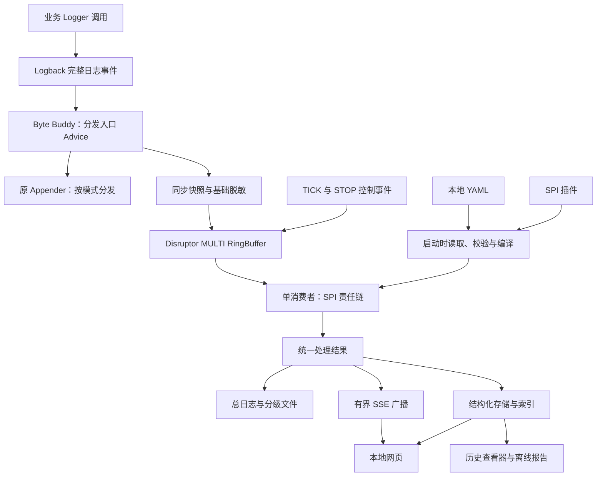

# LogLens：Java 本地日志工作台详细架构设计

> 状态：待实现方案。类名、配置、命令和 API 是实现约定，不代表仓库已有这些能力。LogLens 为暂定名称。

## 1. 目标与范围

开发者在 Java 启动命令中加入 Agent，即可采集现有应用的完整日志事件，无须修改业务中的 `log.info()` 等调用。工具通过 Disruptor 和可扩展责任链完成脱敏、模板识别、重复折叠、业务字段提取和高亮标记。处理结果写入分级文件，在本地网页中实时查看，并可在应用退出后查看历史。

使用闭环：准备 Agent 和本地 YAML → 启动应用 → 浏览器阅读处理结果 → 修改配置或 SPI 插件并重启应用 → 保存、查询和分享历史。

第一版支持 Java 17/21、Logback Classic、一个 Agent 对应一个 JVM、本地 YAML、启动时插件加载、文件与网页。Logback 支持版本区间由兼容测试确定后发布。多 JVM 使用不同会话目录和端口。

第一版不做配置中心、多进程集中平台、动态 Attach、运行时插件 JAR 热加载、任意 System.out 捕获或完整跨服务追踪。traceId 只能关联已捕获的日志，不能凭此推断完整调用图。

## 2. 接入与产物

```bash
java -javaagent:loglens-agent.jar=config=./loglens.yaml -jar app.jar
```

`-javaagent` 位于 `-jar` 前，是 JVM 标准参数。`config=...` 是工具自定义的 Agent 参数，通过 `premain(String agentArgs, Instrumentation inst)` 接收。Manifest 声明 Premain-Class，premain 在应用 main 前安装 Byte Buddy Transformer。

仅把工具加入 Maven 依赖不会自动启用增强。普通使用者获取独立 Agent JAR；自定义插件依赖 loglens-api，推荐 provided，不把第二份 API 打进插件。可通过构建插件复制 Agent 到 target，但启动仍使用 javaagent。

| 产物 | 用途 |
|---|---|
| loglens-agent.jar | 自包含 Agent、默认处理器、运行时和内嵌页面 |
| loglens-api.jar | 自定义链与节点的编译接口 |
| loglens-viewer.jar | 只读查看历史会话和导出 HTML |
| 示例插件 | 演示节点替换与完整链 SPI |

配置路径相对启动工作目录解析，配置中的输出和插件路径相对 YAML 所在目录解析。启动诊断打印最终绝对路径。

## 3. 总体架构



运行时外围负责归一化、大小限制、基础脱敏和最终输出。用户链负责可替换的语义处理，因此替换整链不会意外删除输出能力。基础脱敏只覆盖配置规则，不保证自动识别所有敏感信息。

## 4. 日志增强与输出接管

### 4.1 拦截位置

第一版选择 Logback 创建完整事件后的分发边界，可考察 `Logger.callAppenders(ILoggingEvent)`，最终切点必须按支持版本源码和测试确定。不能把内部方法当成跨版本稳定 API。

采集一次逻辑日志事件，不在每个 Appender 上重复采集。多个 Console/File/AsyncAppender 不应产生重复事件。此时堆栈已经是事件内的异常信息，不需要重新拼接文本多行。

只采集已通过原框架级别与过滤器的事件。工具配置捕获 DEBUG 不会自动开启业务 Logger 的 DEBUG。

### 4.2 输出模式

| 模式 | 原输出 | 处理输出 |
|---|---|---|
| observe | 原有 Appender 全部继续运行 | 旁路生成文件与网页 |
| replace-console | 接管指定控制台，其他 Appender 保留 | 处理文件、网页，可选降噪终端 |

不能简单跳过整个 callAppenders，否则 FileAppender 一起消失。接管采用指定 Appender 分支跳过，并测试 Logger additivity、继承、日志配置重置和重建。

第一版只接管显式配置名称的直接 ConsoleAppender。目标如果是同时包装 Console 和 File 的 AsyncAppender，不跳过整个包装器；报告不支持并回退 observe。后续适配器再支持复杂包装关系。

运行时和输出准备好后才能激活接管。当前事件入缓冲失败时，保留该事件原控制台输出；成功接管的事件才替代输出。磁盘故障请求解除接管。检测前已接管但尚未保存的事件仍可能丢失，故障回退不等于零丢失。

### 4.3 快照与递归保护

原日志线程捕获格式化消息、原模板、Logger、级别、事件时间、线程名、MDC 副本和异常快照。异步消费者不能再读原线程 MDC。调用者位置默认关闭。

不跨线程保留原事件、参数对象或 Throwable，避免持有对象图和应用 ClassLoader。参数转换为有长度限制的字符串；限制消息、MDC、堆栈大小并标记截断，字符串转换异常被隔离。

诊断使用独立 stderr/诊断文件，不经过业务日志框架。采集使用 ThreadLocal 重入保护，finally 清理。插件诊断也通过专用诊断接口输出。

## 5. 类加载与 SPI 发现

Agent 运行时使用隔离 ClassLoader，第三方依赖按打包策略隔离/重定位，并验证服务资源合并，避免污染应用依赖。

被增强类只调用 bootstrap 可见的最小 CaptureBridge。桥独立打包，仅依赖 JDK 类型。可同步传递 Object 类型的原事件给注册回调，由适配器立即复制；原事件绝不留到后台。桥不引用 Logback、插件 API 或运行时第三方库。

运行时仅有一份 loglens-api。插件 ClassLoader 对 API 包父优先，共享相同类型身份；插件不得重打包 API。第一版从 YAML 指定的外部 plugins 目录加载，不默认扫描应用依赖或 Spring Boot 嵌套 JAR。明确指定 ClassLoader 调用 ServiceLoader，不依赖不确定的线程上下文加载器。

插件文件按路径排序，检查 providerId 冲突和重复 API。配置与插件在启动时一次性装配；修改配置或增删插件后，重启应用才能生效。

## 6. Disruptor 与线程模型

| 线程 | 职责 |
|---|---|
| 业务日志线程 | 快照、非阻塞发布 |
| 单消费者 | 责任链、节点状态、文件顺序写入 |
| Agent 启动线程 | 一次性读取、校验配置并装配责任链 |
| 定时线程 | 发布 tick，不直接操作节点状态 |
| HTTP/SSE 线程 | 历史查询与客户端推送 |

RingBuffer 使用 MULTI 生产者，容量为 2 的幂。信封包含 LOG、TICK、STOP；控制事件由运行时消费，不经过用户日志链。单消费者使有状态节点不需要自行并发修改。

默认 DROP_NEWEST：非阻塞申请槽位，满时计数并放弃工具采集。可显式启用 BLOCK，但会阻塞业务线程。第一版不覆盖未消费槽位、不宣称 ERROR 永不丢失。replace-console 下发布失败保留原控制台路径。

申请、填充、提交采用 finally 提交；填充异常标记 INVALID，避免未提交序列卡住消费。先做轻量范围检查，不在占用槽位后执行耗时逻辑。消费结束清除槽位引用，节点暂存和网页推送使用独立快照。

tick 可合并或在下一事件补做刷新；stop 由停机协调线程有限等待和重试，不能静默丢失。网页慢连接不会阻塞消费；磁盘慢会拖慢消费者，表现为积压和按策略丢弃，不另建无界队列。

事件同时保存 eventTime、capturedAt 和 captureSequence。消费顺序是接收顺序，不保证多线程事件时间严格有序。

## 7. SPI 责任链扩展

### 7.1 扩展接口

```java
public interface LogChainProvider {
    ChainDefinition create(ChainBuildContext context);
}

public interface LogProcessorFactory {
    String providerId();
    LogProcessor create(NodeDefinition definition, NodeDependencies dependencies);
}

public interface LogProcessor extends AutoCloseable {
    String nodeId();
    void process(LogContext context, ChainContinuation next);
    default void flush(FlushContext context, EventEmitter downstream) {}
    default void close() {}
}

public interface ChainContinuation {
    void proceed(LogContext context);
}
```

接口为契约草案，实现前统一类型。AbstractLogProcessor 封装配置读取、nodeId 和命中记录。

SPI 注册文件：

```text
META-INF/services/io.loglens.api.LogChainProvider
META-INF/services/io.loglens.api.LogProcessorFactory
```

内容为实现类全限定名。整链提供者零个时显式回退 DefaultChainProvider，一个时使用用户链，多个时装配失败并列出冲突。默认链不重复注册成用户候选。

节点工厂通过 providerId 查找，不允许重复 ID。用户替换某节点时在 YAML 中选择自定义 provider，也可以提供整个 ChainDefinition，自定义插入、删除和顺序。

### 7.2 执行约束

- process 调用一次 proceed 表示继续，不调用表示丢弃或暂存，记录原因。
- 每个调用拥有独立链游标，不能用全局可变 index。
- 第一版普通输入最多 proceed 一次；窗口 flush 可以产生多条事件。
- flush 的 emitter 由运行时绑定到该节点下游，不重新经过该节点，避免再折叠。
- 节点只在消费者线程执行，不允许网络阻塞、无界缓存或异步保留 continuation。
- process 异常默认将进入该节点前的已脱敏快照送到输出末端并标记处理失败，不重复前序链；可配置 DROP。
- flush 失败标记未完整刷新。无限阻塞插件无法靠 catch 隔离，需要明确线程契约和耗时诊断。

### 7.3 默认链

| 节点 | 用途 | 配置 |
|---|---|---|
| FieldExtract | 提取订单号等业务字段 | 预编译正则、MDC 映射 |
| Template | 优先原日志模板，必要时归一化动态字段 | 替换规则 |
| RepeatFold | 相同模板窗口汇总 | 窗口、分组键、容量、等级例外 |
| Correlation | 标记 traceId/orderId，方便查询 | 关联字段 |
| Highlight | 错误、关键词、首次模板标签 | 条件、首次模板缓存容量 |

网页筛选只是查看条件，不等于链中丢弃。永久丢弃必须显式配置，并显示计数。

## 8. 重复折叠语义

默认分组键为 logger、level、template、exceptionType。是否加入 traceId 由用户决定：加入便于单请求调试，不加入便于系统降噪。没有原模板时用规则归一化，不能把不同异常统一折叠。

固定窗口从该组首条捕获开始，持续时间使用单调时钟，展示时间用墙上时钟。每条已脱敏事件先写 captured 明细，节点只暂存摘要和有限样本。

窗口关闭输出 FINAL：单条为 NORMAL，多条为 AGGREGATE，包含 firstSeen、lastSeen、repeatCount 和源引用。第一版不持续更新可变摘要，因此普通折叠日志最多延迟一个窗口，ERROR 默认绕过折叠立即输出。

tick、后续事件、容量驱逐和正常停机均触发消费者刷新。maxGroups 满时提前刷新最早组，标记 CAPACITY。展开明细从存储查询，不在内存中保留全部消息。

原始明细指脱敏后的捕获快照，默认不留未脱敏副本。强杀可能没有 FINAL 汇总，查看器展示已有 captured 明细并说明未完成处理，不伪造汇总。

## 9. 本地配置

```yaml
schemaVersion: 1
application: order-demo
agent:
  mode: replace-console
  consoleAppenderNames: [CONSOLE]
  failurePolicy: FALLBACK_OBSERVE
  pluginsDirectory: ./plugins
capture:
  levels: [TRACE, DEBUG, INFO, WARN, ERROR]
  includeLoggers: [com.example]
  excludeLoggers: [io.loglens]
  maxMessageChars: 16384
  maxStackFrames: 128
  captureCaller: false
runtime:
  ringBufferSize: 8192
  overflowPolicy: DROP_NEWEST
  tickMillis: 200
  shutdownTimeoutMillis: 5000
redaction:
  mdcKeys: [token, password]
  messageRules:
    - id: token
      pattern: '(token=)[^\s,]+'
      replacement: '$1***'
pipeline:
  - id: extract
    provider: builtin-field-extract
    config:
      rules:
        - field: orderId
          pattern: 'orderId=(?<value>[A-Za-z0-9-]+)'
  - id: template
    provider: builtin-template
    config:
      preferOriginalTemplate: true
  - id: fold
    provider: builtin-repeat-fold
    config:
      windowMillis: 3000
      maxGroups: 10000
      maxSamplesPerGroup: 3
      bypassLevels: [ERROR]
      groupBy: [logger, level, template, exceptionType]
  - id: correlate
    provider: builtin-correlation
    config:
      fields: [traceId, orderId]
  - id: highlight
    provider: builtin-highlight
    config:
      firstOccurrence: true
      maxSeenTemplates: 10000
      keywords: [支付超时, NullPointerException]
output:
  directory: ./logs
  text:
    combined: true
    splitByLevel: true
    rotateSizeMiB: 100
    retentionDays: 7
  structured:
    enabled: true
    rotateSizeMiB: 100
    maxDiskMiB: 2048
  console:
    processed: false
web:
  enabled: true
  host: 127.0.0.1
  port: 9527
  recentRecords: 5000
  clientQueueSize: 1000
```

replace-console 配合 processed=false 表示不再刷控制台，查看文件或网页。网页关闭不影响文件。

### 9.1 启动时固定配置

Agent 在 premain 中一次性读取配置文件，校验 schemaVersion、未知字段、节点 ID、provider、正则、数值范围、路径和节点顺序，然后编译规则、装配责任链。校验成功后形成不可变配置快照，整个进程生命周期使用同一份配置。

所有配置变更都需要重启被接入的 Java 应用才能生效，包括采集范围、脱敏、节点启停/顺序/provider、节点参数、输出和网页设置。运行期间修改或删除配置文件，不影响已经运行的配置和责任链；不启动文件监听器或定期检查任务。

启动时缺失或非法配置按第 13 节初始化失败策略处理，明确输出错误，不静默部分应用。每次重启创建新会话并重新初始化节点状态，不在会话之间迁移折叠窗口或首次出现记录。

会话元数据保存本次实际加载的配置摘要和 configHash，便于区分不同启动的规则。摘要不包含明文敏感值；网页显示的是已加载配置，不重新读取磁盘文件作为当前运行状态。

## 10. 数据与存储

| 模型 | 关键字段 |
|---|---|
| CapturedLog | eventId、sessionId、captureSequence、eventTime、capturedAt、level、logger、thread、template、message、exception、MDC、truncated |
| LogContext | 事件、业务字段、标签、规则命中；固定配置通过会话关联 |
| ProcessedRecord | recordId、recordSequence、NORMAL/AGGREGATE、level、message、firstSeen、lastSeen、repeatCount、sourceRefs |
| RuleDecision | nodeId、ruleId、action、reason |
| SessionMetadata | 应用、运行版本、开始/结束、固定配置摘要与 configHash、存储片段、丢弃计数、完成状态 |

默认只记录命中规则，逐节点耗时诊断可选。窗口使输出顺序不同于捕获顺序，两者独立编号。

```text
logs/order-demo/<session-id>/
├─ session.json
├─ diagnostics.log
├─ app-0001.log
├─ error-0001.log
├─ warn-0001.log
├─ info-0001.log
├─ debug-0001.log
├─ trace-0001.log
├─ captured-0001.jsonl
├─ processed-0001.jsonl
└─ index.sqlite
```

文本存处理后的 FINAL 记录，分级文件精确匹配等级，总日志保留全部等级。captured 保存已脱敏明细，processed 是文件和网页的统一处理结果。显式 DROP 是否保留明细由策略决定，默认保留用于解释。

JSONL 是可重建依据，SQLite 是查询索引，保存等级、时间、Logger、关联字段、segment 与 offset。单写入线程追加文件，再更新索引，再广播。批量缓冲时网页记录不代表已 fsync，不承诺崩溃零丢失。

在线查询索引支持策略选择：默认 SQLite，亦可配置 Elasticsearch。两者只替换查询索引，不替换 JSONL 事实归档、责任链/RepeatFold、文本输出或 SSE；索引文档保存查询字段和 JSONL 字节位置，命中后读取完整记录。离线 History Viewer 始终从 JSONL 重建私有 SQLite 索引，因此不依赖运行时 Elasticsearch。SQLite 默认模式保留原有行为。

多个文件写入不构成原子事务，使用 recordId 对齐。结构化成功而文本失败时标记降级；查看器可重建索引、忽略末尾不完整 JSON 行、重新导出文本。

按日期/大小滚动，按期限和磁盘上限清理关闭的 segment，并清理索引引用，不删除当前写入文件。汇总明细过期时显示“明细已过期”。磁盘满解除控制台接管并报告，不在内存无限等待。

## 11. 网页、API 与离线查看

### 11.1 UI 结构

- 顶栏：应用与会话、连接状态、搜索、暂停跟随。
- 左栏：等级、Logger、标签、traceId/orderId 等筛选。
- 中栏：虚拟滚动日志流，重复次数、持续时间、首次异常突出展示。
- 右栏：完整消息、可折叠堆栈、MDC、关联记录、命中规则、重复明细。
- 状态区：丢弃数量、输出健康；技术详情按需展开。

深浅主题、克制的等级颜色、消息等宽字体、清晰行距。状态同时提供文字和图标。长消息默认截断。暂停跟随冻结滚动而不停止接收，显示新日志数量。筛选同步 URL；点击订单号创建临时关注镜头，不修改 YAML 或底层保存。

| API | 用途 |
|---|---|
| GET /api/session | 会话与版本 |
| GET /api/records?cursor=...&level=... | 筛选与游标分页 |
| GET /api/records/{id} | 详情 |
| GET /api/records/{id}/sources | 重复明细分页 |
| GET /api/events | SSE 记录、gap 与健康信息 |
| GET /api/config | 本次启动加载的脱敏配置摘要与 configHash |
| GET /api/health | 缓冲与输出状态 |

网页第一版只读，规则通过修改本地文件并重启应用生效。每个 SSE 客户端队列有界，过慢时断开/通知 gap，再按序号补齐。先建立订阅并取得水位，再查询水位前历史，最后合并去重，防止历史/实时切换漏记录。

默认仅 loopback，不开放跨域。日志按文本渲染，不用 innerHTML，限制查询大小。离线 HTML 自包含样式与脚本，安全编码内嵌数据，避免 `</script>` 逃逸；限制导出大小和 DOM 数量。

独立 viewer 以只读方式打开历史目录，复用 UI 和查询模块，不启动 Agent，不重新改变旧处理结果。历史按新规则回放属于后续功能。

## 12. 模块结构

```text
loglens/
├─ loglens-api/               事件与 SPI 契约
├─ loglens-bootstrap/         JDK-only 采集桥
├─ loglens-agent/             premain、Byte Buddy、类加载与打包
├─ loglens-adapter-logback/   切点、快照、控制台接管
├─ loglens-runtime/           Disruptor、链、状态与生命周期
├─ loglens-processors/        默认节点与工厂
├─ loglens-config/            启动时 YAML 读取、校验与不可变配置
├─ loglens-storage/           文本、JSONL、索引与保留
├─ loglens-web/               HTTP、SSE、查询
├─ loglens-ui/                前端，构建资源嵌入 Agent
├─ loglens-viewer/            历史与导出
├─ examples/logback-demo/     普通 Java/Spring Boot 示例
├─ examples/custom-plugin/    节点替换与整链 SPI 示例
└─ docs/
```

API 不依赖日志框架、Byte Buddy、Disruptor 或前端。适配器处理框架差异；运行时只处理统一事件；输出与语义链分离。

## 13. 生命周期与故障策略

启动：参数 → 独立诊断 → 配置/插件 → 链校验 → 存储 → 消费者/Web → 捕获桥/Transformer → 激活接管并打印地址。

默认初始化失败禁用 Agent、保留原日志、让应用继续；STRICT 可用于 CI，初始化失败终止启动。端口冲突、SPI 冲突或缺失配置都要有明确诊断。

退出：停止采集并解除接管 → 有限时间排空 → flush 窗口 → 刷新文件/索引 → 写会话结束 → 关闭线程、插件和加载器。不能假定 Agent 与 Logback shutdown hook 顺序；退出期间新日志走原路径，捕获尽力而为。

超过期限标记未完整结束。强杀与 JVM 崩溃不保证 flush、hook 或文件缓冲保存。

| 故障 | 行为 |
|---|---|
| 启动配置非法 | 初始化失败，按默认回退或 STRICT 策略处理 |
| 节点抛异常 | 输出失败标记或按配置 DROP |
| 插件长期阻塞 | 无法强制安全隔离，记录耗时并明确契约 |
| 缓冲满 | 计数，接管事件走原控制台 |
| 慢网页客户端 | 断开与补齐，不拖慢消费 |
| 文件/索引故障 | 降级诊断与解除接管 |
| 不支持框架版本 | 禁用适配器并说明 |

## 14. 实施顺序与验收

1. 验证接入：普通 Java 和 Spring Boot 下 Logback 事件、快照、一次采集、类加载与 observe。
2. 实现闭环：Disruptor、默认链、SPI、窗口、分级文件、JSONL。
3. 实现固定配置与接管：启动校验、不可变配置、直接 ConsoleAppender 接管。
4. 实现网页：索引、SSE、虚拟列表、详情、镜头、历史与安全导出。
5. 验证可靠性和性能：比较未启用/observe/replace-console 的日志调用延迟、吞吐、CPU、GC、内存、磁盘和丢弃量，按实测制定目标。

| 场景 | 验收结果 |
|---|---|
| 多 Appender/additivity | 一条事件仅采集一次，原文件输出保留 |
| 框架关闭 DEBUG | 不凭空生成 DEBUG |
| 相同模板不同参数 | 汇总正确，明细可展开 |
| ERROR 刷屏 | 默认即时输出 |
| 自定义节点/整链 SPI | 替换生效且外围输出完整 |
| 多整链提供者 | 冲突明确 |
| Spring Boot 外部插件 | 无 API 类型冲突 |
| 运行期间修改配置 | 当前配置和节点保持不变 |
| 修改合法配置后重启 | 新会话使用新配置，节点状态重新初始化 |
| 使用非法配置启动 | 明确错误并执行初始化失败策略 |
| 日志含 HTML | 页面与导出按文本显示 |
| 缓冲满与慢客户端 | 丢弃准确，默认不阻塞业务 |
| 磁盘满 | 明确故障与接管回退 |
| 正常退出与强杀 | 正常 flush；强杀不伪造完整结果 |
| 十万行历史 | 分页、虚拟列表、内存有界 |

窗口测试使用可控时钟；事件发生器使用固定种子，产生正常消息、重复异常、不同 traceId、长堆栈和敏感字段。第一版演示不依赖远端服务。

## 15. 技术依据

- [Java Instrumentation](https://docs.oracle.com/en/java/javase/26/docs/api/java.instrument/java/lang/instrument/package-summary.html)：javaagent/premain/Manifest；实现按 Java 17/21 核对 API。
- [Byte Buddy 官方项目](https://github.com/raphw/byte-buddy)：AgentBuilder 与 Agent 示例。
- [Logback 架构](https://logback.qos.ch/manual/architecture.html)：完整事件、Logger、Appender、MDC。
- [Logback Appender](https://logback.qos.ch/manual/appenders.html)：分发和生命周期。
- [Disruptor 指南](https://lmax-exchange.github.io/disruptor/user-guide/)：进程内有界缓冲与消费者序列。

这些资料支持基础机制。责任链、接管策略、启动配置、存储和 UI 是本项目设计；实现前优先验证切点和类加载，不提前承诺全版本兼容或无性能开销。
