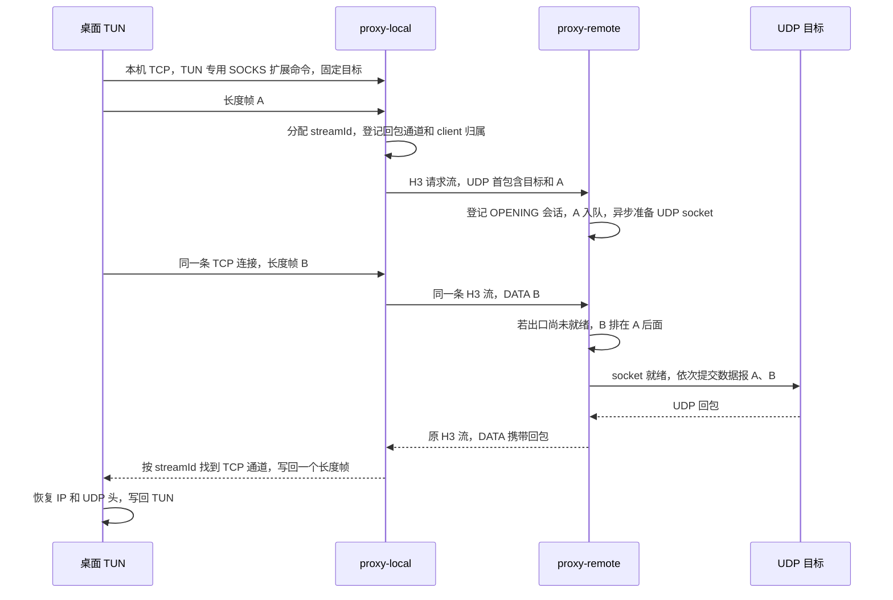

# 桌面 TUN 通过本机 TCP 和远端 HTTP/3 转发 UDP

**状态：桌面 TCP 分帧路径已实现。** 2026-11-22。对照基线为 `1312fb8`。本文讨论桌面 TUN 路由结果为 `PROXY` 的 UDP 流。本轮功能验证、远端主机 OOM 和清理情况见[本轮验收记录](../sdd/desktop-udp/framed-udp-verification.md)。上一版标准 SOCKS5 UDP 中继见[原设计](../sdd/desktop-udp/design.md)和[上次灰度记录](../sdd/desktop-udp/canary-verification.md)。

## 设计意图

TUN 和 proxy-local 都由项目控制，可以约定在现有的本机 TCP 连接上传送带长度的 UDP 数据报。local 复用协议嗅探、当前节点的 invoker、HTTP/3 client 和下行通道注册表。remote 收到携带业务数据的首包时创建固定目标的 UDP 出站会话，socket 就绪后发出首包。业务上行提交后立即返回，下行由 ExchangeHandler 独立推送。

| 环节 | 基线实现 | 本次实现 |
|---|---|---|
| TUN → local | TCP 协商 SOCKS5 UDP ASSOCIATE，另开本机 UDP 中继，业务包发往中继端口 | TUN 用同一条本机 TCP 连接发送扩展命令和业务帧，回包也走这条连接 |
| local → remote 首包 | local 暂存业务包，发送 UDP_CONNECT，等待 udp-v1 确认后才发送 DATA | 第一条代理消息携带 UDP 类型、目标和首个数据报，走单向发送路径 |
| remote 出口 | 收到 UDP_CONNECT 后建 socket，准备好后回复 local | 收到首包先登记会话、缓存首包，再异步建 socket；建好后按序写出 |
| local 下行 | UDP receiver 按 streamId 找到 SOCKS 关联和客户端 UDP 端点 | 桌面 TUN 流复用 streamId → 本机 TCP channel 注册表，由出站编码器补长度 |

建议每个应用 UDP 四元组对应一条本机 TCP 连接、一个逻辑 streamId、一条 H3 双向请求流和一个远端 UDP socket。多条流共享已选节点的 QUIC 连接。这一选择用每流一个本机 TCP 连接的成本，换取简单的回包寻址和独立关闭。普通 SOCKS5 客户端继续使用标准 UDP ASSOCIATE；固定走原路径的客户端仍可使用旧协议。Android、DIRECT 出口、DNS 专用处理均沿用各自既有路径。

## 端到端架构与时序

以下用两个连续数据报 A、B 说明首包的归属。应用看到 FakeIP 时，TUN 保存原四元组，向 remote 传递反查得到的目标域名，回包时恢复应用最初访问的地址。

### 本机接入与报文边界

1. 现有 TCP listener 和 ProtocolDetector 接收连接。SOCKS5 协商后由命令解码器区分 TCP CONNECT、标准 UDP ASSOCIATE 和 TUN 专用扩展命令。专用命令使用 `05 F0 00 ATYP ADDR PORT`，接受本机约定的来源地址 `127.0.0.2`。成功应答仅确认 local 已安装帧处理器。
2. 扩展分支安装双向帧编解码器和 UDP 转发 handler。建议一帧使用两字节网络序长度加一个 UDP payload，上下行格式相同。首期沿用 0–1472 字节范围；长度为零代表一个有效的空数据报，TCP EOF 表示流关闭。解码器处理拆包、粘包，以及命令末尾和首个业务帧同次到达的情况。
3. 一个本机连接固定一个目标，所以每个业务帧只需携带长度和载荷。TUN 已作出的 PROXY 决策沿用现有内部路由标记，避免 local 把已选代理的目标再次分流。这个本地路由标记与线上 UDP 类型分别编码。

### local 建流、上行和下行

- 首包进入 handler 时，先分配 streamId、注册本机 TCP 通道，再通过 ClusterInvoker 把首包提交给当前节点。在选中的 client 上把流归属登记与首发、退役互斥协调，确保即使回包极快或节点同时切换，也能定位或清理该流。现有 TCP 代码同样在 CONNECT 之前分配 ID。
- 新消息 UDP_OPEN 的线上编号为 7，携带 streamId、目标和首包字节。后续 DATA 沿用同一 streamId，允许空载荷。首包和 DATA 都走单向 send。H3 服务端在已有 POST /proxy 的 200 应答头中声明 `x-plane-udp-open: 1`。客户端确认能力后提交首包，未声明能力就关闭该流。
- 当前流归属登记挂在 HeaderExchangeClient.request() → trackRequest() 上。单向首包绕过了这一步，需把“登记所属 client”与“登记等待应答的 DefaultFuture”拆开。后续 DATA 只写已存在的流，下行仍使用原 client 的 ExchangeHandler 和流注册表。
- remote 推回 DATA 后，由本机 TCP 通道的出站编码器给载荷补长度。实现时要检查空 DATA 的分支，确保 TCP 路径对空缓冲的处理不会吞掉一个合法的 UDP 空包。TUN 解帧后按原四元组写回应用。

### remote 建 socket 与竞态

DispatchInvoker 按线上首包类型分发。首包必须在该 H3 流的串行接收路径上**先发布 OPENING 会话并将 A 入队**，随后才能把解析目标和准备 UDP socket 的工作异步提交。否则紧随其后的 B 可能先查表，发现会话不存在。这里创建的是 remote 到目标的 UDP socket；local 已经持有选中节点的 H3 client。

| 事件 | 会话拥有者执行的操作 |
|---|---|
| 首包 A | 按所属 H3 通道和逻辑 streamId 唯一登记会话，A 入队，只启动一次异步准备 |
| OPENING 期间收到 B | 在同一有界 FIFO 追加 B。普通 DATA 不能创建未知会话 |
| socket 就绪 | 将完成事件投回同一个 EventLoop，检查当前会话身份。统一提交队列头的包；积压清空后才开放直写。若分批排空或暂时不可写，新包始终排到队尾 |
| 首包重复、建立失败、超时或通道关闭 | 重复首包不得新建第二个 socket；失败和关闭时撤销会话，释放队列，通知对端关闭该流。已退役会话的完成回调只关闭迟到的 socket |
| 目标回包 | 校验固定目标端点，沿原会话写回 DATA。断线或节点切换后丢弃旧回包，后续新流重新分配 ID |

用户提出用 Disruptor 暂存建立期间的数据。**本稿建议先采用每会话有界 FIFO，由该流的单一 EventLoop 决定入队、出队和提交写入。** 若使用 Disruptor，同一会话的数据到达、建 socket 完成和关闭事件也必须串行处理，不能让刚到的包绕过队列从其他线程直接写。两种实现都要限制包数、字节数和异步写入数，队列满时丢弃新数据报并计数。需要保证的是本端提交次序，外部 UDP 网络仍可能丢包或乱序。

## 节点切换时如何关闭连接

假设桌面应用通过节点 A 发包，正在使用本机 TCP 通道和逻辑流 42。切到节点 B 时，**流 42 随 A 的 client 一起退役**。本机 TCP 监听继续接收连接，应用的 UDP socket 也由应用继续持有。新节点就绪后，即便应用继续使用相同四元组，TUN 收到的新数据报也要走新的本机 TCP 通道、新的 streamId 和 B 的 H3 请求流。A 上已提交的业务包可能已经到达目标，切换时不重放。

| 顺序 | 拟议 UDP 路径的关闭动作 |
|---|---|
| 1. 暂停接单 | 手动改选节点和自动判定当前节点故障，共用控制器的 `retireCurrent()`。先把 `currentInvoker` 置空，在与业务分发相同的同步边界上停止向 A 提交新首包。首包若已注册本机通道、却未获得 client，立即撤销注册并关闭该通道。切换窗口到达的数据报允许丢弃。 |
| 2. local 关闭 A 的流 | 沿 `ClientInvoker.close() → HeaderExchangeClient.close()` 退役旧 client。ExchangeHandler 按该 client 的 `ownedStreams` 清理注册并关闭各流对应的本机 TCP 通道。新方案的单向 UDP 首包也必须在发送前登记归属，H3 stream 尚未打开时同样能被找到。TUN 收到 EOF 或读写错误后终止旧 flow，丢弃尚未发送的帧。 |
| 3. 关闭 A 的 H3 连接 | `Http3Client.close()` 停止该 client 的重连任务，使其 H3 请求流失效、释放待发送队列，随后关闭与 A 的 QUIC 连接。旧 handler 的 DATA、DISCONNECT 和关闭回调只作用于原 client，不能经已更新的 current 再投向 B。 |
| 4. remote 回收出口 | remote 观察到入站 H3 流关闭时，由 SessionManager 按具体 session 实例移除并关闭。对 OPENING 会话，取消建 socket、丢弃 FIFO；若取消后才返回一个 socket，立即关闭它。对 ACTIVE 会话，停止排队写入、关闭 UDP socket 并释放额度。断网时 remote 可能要等 QUIC 检测到失联或会话超时，本机切换无需等待远端确认。 |
| 5. B 接收新流 | 控制器发布可用的 B 后，TUN 用后续新数据报重新建流。旧 flow 的退出回调只能删除自身那一代的四元组映射；local/remote 的迟到回包或重复关闭也只匹配原 client、通道和会话实例。即使发生 A → B → A，节点名称相同也不能认作同一个 client。 |

实现时，首包归属登记须与 client 退役互斥；后续发送、下行推送和注销都要核对同一归属。这样即使本机 TCP 关闭、H3 关流和远端异步完成同时触发，每项资源也只释放一次。现有代码可复用的入口见[节点控制器](../../proxy-local/src/main/java/com/proxy/local/config/Http3NodeController.java)、[集群分发](../../proxy-cluster/src/main/java/com/proxy/cluster/StickyClusterInvoker.java)、[交换客户端](../../proxy-exchange/src/main/java/com/proxy/exchange/header/HeaderExchangeClient.java)和[远端会话回收](../../proxy-remote/src/main/java/com/proxy/remote/outbound/SessionManager.java)。

## 代码落点

| 层 | 阅读入口 | 拟改职责 |
|---|---|---|
| 桌面 TUN | [udp.rs](../../tun-adapter/src/udp.rs) | 在 PROXY 分支改用 TCP 帧收发，复用四元组、FakeIP 和回包构造 |
| local 接入 | [Socks5CommandDecoder](../../proxy-local/src/main/java/com/proxy/local/handler/Socks5CommandDecoder.java)、[StreamChannelRegistry](../../proxy-local/src/main/java/com/proxy/local/handler/StreamChannelRegistry.java) | 分发扩展命令，新增 TCP 上的 UDP 帧处理，使用原通道注册表 |
| 消息与节点 | [ProxyMessage](../../proxy-common/src/main/java/com/proxy/common/model/ProxyMessage.java)、[StickyClusterInvoker](../../proxy-cluster/src/main/java/com/proxy/cluster/StickyClusterInvoker.java)、[ClientInvoker](../../proxy-cluster/src/main/java/com/proxy/cluster/ClientInvoker.java) | 编码线上首包类型，放行新消息，并在当前节点走单向发送 |
| H3 与交换层 | [Http3Client](../../proxy-transport-http3/src/main/java/com/proxy/transport/http3/Http3Client.java)、[HeaderExchangeClient](../../proxy-exchange/src/main/java/com/proxy/exchange/header/HeaderExchangeClient.java)、[ExchangeHandler](../../proxy-exchange/src/main/java/com/proxy/exchange/header/ExchangeHandler.java) | 允许首包开 H3 流，复用已有发送队列；补上单向建流的归属登记、下行和关闭处理 |
| remote | [DispatchInvoker](../../proxy-remote/src/main/java/com/proxy/remote/dispatch/DispatchInvoker.java)、[OutboundConnector](../../proxy-remote/src/main/java/com/proxy/remote/outbound/OutboundConnector.java)、[OutboundSession](../../proxy-remote/src/main/java/com/proxy/remote/outbound/OutboundSession.java) | 按首包建立异步 UDP 出口，在会话内有序提交积压数据，复用已有目标端点校验和回写 |

## 兼容与验收

现有 remote 要求 UDP_CONNECT 的载荷精确等于 udp-v1。新首包需要可区分的线上编码。建议先让 remote 同时识别新旧消息，再给明确支持新格式的节点启用桌面新路径。单向首包发送后，不能根据“暂时没有回包”猜测对端版本并重发，否则可能向目标重复投递。建 socket 失败通过关流或异步错误反馈给 local。

实施后应分别验证以下行为：

- 本机扩展命令与首帧合并、帧拆分、连续多帧、空包、最大包、超限帧和 TCP 半帧 EOF；上下行逐包校验。本机 TUN 新路径全程只使用原 TCP 监听。
- 在可控 echo 环境延迟 UDP socket 就绪，先送 A、B，再在排空期间送 C，在 remote 出口断言只创建一个 socket，写入顺序为 A、B、C。覆盖队列上限、打开失败与关闭后完成的回调。
- 对手动切换、自动故障切换各覆盖三个时点：local 已注册但 H3 流尚未打开、remote 的 socket 正在建立、remote 正在收发。主动触发 EOF 和迟到的 socket 完成回调，检查旧本机通道关闭，旧 client 的归属集合和 H3 待发队列清空，remote 检测断开后会话、socket 与额度回到测试前基线。
- 用同一应用 UDP socket、同一目标依次走 A → B → A，给每一代新包加唯一编号。断言新流能收到自己的回复，旧编号不会在新节点被重发，旧 flow 的退出或迟到回包不会删除或写入新通道。另开一条相同目标、不同源端口的流，检查关闭单流时另一条仍可用。
- 在真实 H3 节点验证本机分帧、FakeIP 回包与远端 UDP 出口，记录首包时序。对原 TCP CONNECT、普通 SOCKS5 UDP ASSOCIATE 和旧版节点分别做兼容回归。

## 附录：作者提示词原文

### 第一轮：基于现有 TCP 架构讨论简化 UDP 链路

> 不是，他这边为什么要这样子呢，我感觉麻烦了啊，对于原来的tcp是这样的，手动选节点模式，启动的时候会填充clusterinvoker，currentinvoker，然后tun模式使用socks协议调用local服务端，然后先嗅探并且更换对应的处理器，使用invoker进行connect，连接成功之后返回之后更换处理器，换成透传处理器，然后创建新流id，通过invoker调用send方法发送数据，提交给client的线程之后直接调用completablefuture.complete快速返回，等待exchangehandler处理器处理并且推送下行数据给浏览器的对应的通道，相当于上行数据不会等待下行数据的返回，这一点跟dubbo完全不一样，dubbo每个请求都会创建DefaultFuture，然后返回等待响应到来之后调用完成方法。。。。。。然后远端收到之后对于connect或者data数据，dispatchinvoker会分发对应的执行逻辑，最终都是通过outboundsession落实的。切换的时候无论是手动还是自动的，只不过是切换的条件不一样，切换的过程就是设置currentinvoker为null，调整clusterinvoker，使用exchangehandler记录的流id集合，流通道注册中心，client类，关闭浏览器通道，client和远端维护的所有流，最后关闭client和server的连接。。。。。。
>
> 言归正传，我想要实现这个udp，我觉得不需要去管这个连接的建立啊，我觉得设计起来非常简单啊根本没有这么麻烦，原先的嗅探处理器可以不用管，然后socks5连接处理器根据TUN传过来的信息决定该怎么做，如果是TCP的话，就正常connect，成功之后再更换处理器，如果是UDP的话，那直接更换一个不用连接，直接中继传输的处理器，这个可以单独列一个处理器，然后调用clusterinvoker的invoke方法的时候注入TCP或者UDP的信息，创建流然后推送过去就可以了，也不用单独列一个流注册中心和集合吧，远端根据标记选择对应的outboundsession呗，你说呢，哦对了，local的server没办法处理udp好像，所以本地是不是可以起两个server，让TUN发往不一样的服务呢，说一下你的看法(不用管这个，纯纯是瞎几把打的思路)。

### 第二轮：明确 TUN 通过 TCP 传输 UDP 帧

> 那local和server的UDP链路我想的就是这样子了，TUN把捕获到的UDP包包装之后通过TCP连接发送给local-server，不用再开udp的端口服务了，协议嗅探更换socks5handler处理器并且根据首包信息确认是UDP请求之后换成这个socks5udp处理器，这个处理器调用invoker直接传输数据，在message消息中包含udp信息即可，到达远端之后分发到对应的处理逻辑中，通过dispatchinvoker实现，然后如果创建客户端的话可以先创建客户端，包什么的先通过这个disruptor队列存储起来，等到创建成功之后，先传输队列中的数据，再把新来的数据传输过去，要做好这里的竞态条件，你说改成这个思路可以吗
