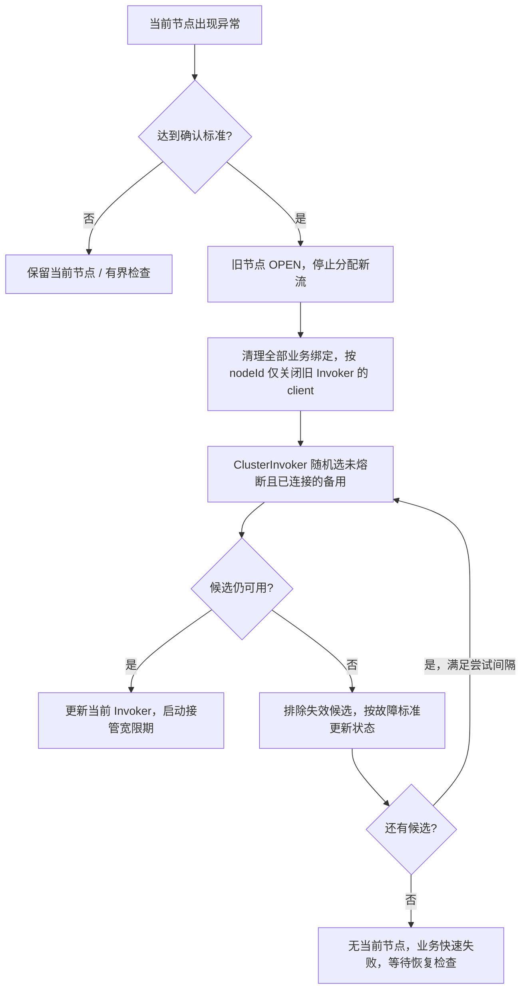

# P3/P4：HTTP/3 自动切换设计与实施验收

> 2026-10-22，设计提案，尚未实现。基于已经完成的 P1/P2；本文中的时间参数是待故障注入验证的初始建议，不代表生产测量结果。

相关文档：[P1/P2 实现](http3-node-selection-p1-p2.md)、[原始总体方案](node-selection-and-failover-plan.md)、[手动切换改造复盘](../手动切换改造复盘：如何约束AI不过度设计.md)。

## P3：自动切换与节点熔断

### 1. 已确认的规则

自动模式启动时优先尝试首选节点。其他节点没有优先级，发生故障时从可选备用节点中随机选择一个，连接成功后持续使用。每个 stream 仍绑定创建它的具体 Invoker，不按请求轮换节点。

当前节点健康就继续使用。首选节点恢复后回到备用，不自动切回。修改首选偏好也不抢占当前健康节点；需要立即指定出口时，用户切到手动模式。

确认故障后复用手动切换的资源退出路径：停止分配旧节点，清理旧 stream，关闭旧 Invoker 和连接，再启用新节点。已建立的 TCP、TLS、下载或 WebSocket 会中断，由应用重新连接；代理不迁移会话、不重放业务请求。

自动模式启动时读取固定节点列表，为每个节点创建绑定 nodeId 的 Invoker，并各建立一条 QUIC 连接，全部加入 ClusterInvoker。健康备用保留预连接，只有当前 Invoker 承接新业务流；没有节点内部连接池。单个节点连接失败不阻止其他节点初始化，也不要求所有节点就绪才提供服务。

自动模式不实现节点列表的运行时增删、参数更新监听。节点列表及连接参数在本次运行中固定，修改后重启代理生效；现有监听保留手动切换所需能力。不要为低频配置变化增加动态集群协调逻辑。

ClusterInvoker 持有全部节点 Invoker 和当前 Invoker。选择策略在启动或确认需要切换时执行：启动优先首选，故障切换时随机筛选未熔断且连接可用的备用；选中后保持当前节点，不在每个 CONNECT 上重新随机。

本阶段只实现 Java local 的 HTTP/3 自动模式，不扩展 HTTP/2、混合传输或 Android 原生核心。保留 ClusterInvoker SPI 和现有过滤器链。

### 2. 三种状态不要混为一谈

| 对象 | 状态 | 含义 |
|---|---|---|
| Invoker 资源 | 已关闭 | 旧连接和所属流已经退出，不能继续使用 |
| 节点熔断器 | CLOSED | 正常状态，可以被选择；不表示已经验证健康 |
| 节点熔断器 | OPEN | 已熔断，冷却期内不能被业务选择 |
| 节点熔断器 | HALF_OPEN | 冷却结束，正在通过受控探测确认恢复 |

因此，“把旧节点标记为 close”在实现中拆成两个明确动作：关闭旧 Invoker；故障节点的熔断器进入 **OPEN**。不能把熔断器 CLOSED 当成禁止选择。

手动切换只退出旧 Invoker，不因为用户换节点就把健康节点记为故障或增加熔断次数。熔断器按节点记录故障、控制恢复资格；ClusterInvoker 根据这些资格调用选择策略并更新当前节点，控制器负责实际客户端的创建和关闭，不另建一套独立节点选择逻辑。

证书、密钥或参数确定无效时记录配置阻塞原因，修正配置并重启后重新加载，不反复尝试。普通网络断开、超时不能仅凭异常文本认定为永久配置错误。

### 3. 故障依据：先证明节点有问题

现有远端 CONNECT 失败是通用错误，没有可靠的“节点故障/目标故障”类型区分。HEARTBEAT 枚举存在也不表示已实现端到端心跳。因此本阶段不能按错误字符串分类，不能直接把 CONNECT 返回 500 当成节点故障。

| 信号 | 处理 |
|---|---|
| 刚开始连接，暂时 isAvailable=false | 等待已有握手超时预算，不计失败 |
| 已投入使用的连接持续不可用 | 给现有重连机制短暂恢复机会，持续达到阈值才确认故障 |
| 某个网站拒绝、DNS 失败、CONNECT 返回远端错误 | 不计节点失败；能收到有效远端响应，说明代理控制路径仍可通信 |
| 业务 CONNECT 超时，原因不明 | 触发一次定向检查，业务超时本身不累加节点失败 |
| 同一节点的独立定向检查连续超时或传输失败 | 达到阈值后确认节点故障 |
| 页面同时产生大量失败流 | 只触发同一个检查任务，不按流数累计 |
| 本地关闭、任务取消、调度延迟 | 不计节点失败 |
| 没有业务流量 | 不算故障，也不因闲置切换 |

有效响应必须来自当前具体客户端上的合法协议响应，不能把本地构造的错误或旧 Invoker 的迟到回调当成恢复信号。

#### 3.1 最小定向检查

检查绕过 ClusterInvoker 的节点选择，直接使用指定节点的 ClientInvoker/ExchangeClient，发起独立 CONNECT。streamId 使用现有全局分配器，不能自己从零计数。检查不绑定浏览器连接，也不进入业务绑定表。

使用项目明确配置的检查目标。成功响应证明远端能建立该目标 TCP 连接；合法的远端错误响应只证明代理控制路径畅通，同样不能据此熔断节点。检查结束、超时、取消时都要释放请求和 transport stream；不能残留探测流。定向检查只等待 CONNECT 响应，不声称验证了 HTTPS 内容。

检查优先复用现有协议和资源关闭接口，不为此增加新心跳协议、浏览器下行缓冲门或新的通用健康框架。实现前必须验证无浏览器上下文的 CONNECT 检查能够完整清理；如果现有接口有缺口，仅补充检查实际需要的关闭能力。

**能力边界：**如果远端控制路径正常，但远端出口全面故障且持续返回通用目标连接错误，P3 不据此自动熔断。这是保守判断的明确边界。不能为了覆盖它，把普通网站故障也算成节点故障。完整出口质量检测另立需求，不在本次暗中加入 HTTPS 探测客户端。

### 4. 建议阈值与防抖

| 参数 | 初始建议 | 作用 |
|---|---|---|
| 初次建连预算 | 复用现有握手超时 | 初始连接未完成不计失败，不另加业务重试层 |
| 新节点宽限期 | 发布可用后 15 秒 | 暂不根据检查超时作软故障切换 |
| 持续断连阈值 | 5 秒 | 短暂断线由现有 HTTP3 重连处理 |
| 单次定向检查超时 | 6 秒 | 检查有界，不能无限等待 |
| 连续检查失败阈值 | 3 次 | 每次为独立检查，不按业务请求数累计 |
| 检查间隔 | 上次检查结束后至少 5 秒 | 不重叠，不补发错过的检查 |
| 最短驻留时间 | 30 秒 | 软故障不频繁切换 |
| 首次熔断冷却 | 30 秒 | 等待恢复，避免立即切回坏节点 |
| 重复失败冷却 | 60、120、240，最多 300 秒 | 附加 0～20% 正向随机延迟，减少同步重试 |
| 恢复确认 | 两次检查成功，间隔至少 5 秒 | 一次偶然恢复不能立即承接业务 |
| 候选尝试间隔 | 至少 5 秒 | 全部不可用时也不快速轮转 |

这些先作为内部策略常量，不一次性暴露十几个配置项。检查超时需要与实际远端目标连接超时对齐，避免远端尚未返回就被本地连续误判；P4 故障注入后调整默认值。

节点失败次数分别归属各自 nodeId 和具体客户端，不能把 A 的失败计数带给 B。新节点接管时启动业务宽限期，但不能清除该节点已有的 OPEN 状态来绕过熔断。宽限期和驻留时间约束软故障；确定配置无效或持续断连达到阈值可以提前退出，不能强留一个已经失联的节点。宽限期间不积攒检查超时，结束后从零开始。

正常时不持续探测健康当前节点和健康备用节点。业务异常触发检查，获得有效远端响应后清零检查失败并停止检查；各节点持续断连由连接状态确认，备用故障也要排除业务选择，但不触发当前节点切换。后台恢复检查全局最多一个，不因预连接数量增加而同时发起大量检查。

重复熔断次数不能因为两次恢复检查就清零。节点真正承接业务稳定至少 60 秒，并观察到有效远端响应后，再重置冷却退避。所有持续时间用单调时钟判断，展示时间另行转换。

### 5. 切换流程



自动启动先尝试首选；首选不可用后，其他候选随机。没有当前节点时，已完成恢复确认的首选可以优先使用；当前健康时不触发这条规则。

关闭和发布按顺序进行。沿用有界 disconnect 等待，超时后仍必须关闭旧客户端，不能无限等确认。若尚无就绪候选，新业务直接得到暂不可用，不排队积压，不透明重试旧 CONNECT；有就绪候选则直接复用预连接。

同一时刻只有当前 Invoker 承载业务，因此切换时可以保留现有 `cluster.retireBindings()`，清理全部业务 stream 绑定并通过各绑定原有的具体 Invoker 发送 DISCONNECT。随后根据旧 nodeId 找到 ClientInvoker，仅关闭它的 client，最后启用下一节点；其他节点的预连接保留。手动切换遵守相同顺序，只有整个代理退出才关闭全部节点。

**沿用现有清理能力：**现有手动版本已按 nodeId 关闭对应 Invoker 的 client，`retireBindings()` 则清理全部业务绑定。全部节点加入集群并预连接后，仍然只有当前节点承载业务，所以无需增加按 Invoker 筛选绑定的方法。切换期间必须先停止旧节点分配新流，待绑定清理和旧 client 关闭后才允许下一节点接收 CONNECT，避免清理到新节点刚建立的绑定；集群成员列表保持不变。定向检查不进入业务绑定表，检查资源按原有检查路径独立收尾。

候选通常已经预连接，切换时不关闭再重连它。初始化尚未完成的节点等待自己的握手结果，不因构造过程中短暂不可用而被判死。握手预算耗尽是真实的连接失败，可以熔断。每轮候选最多检查一次，不因浏览器请求涌入增加尝试次数。

### 6. 恢复与资源所有权

OPEN 到期仅允许进入 HALF_OPEN，重新为该 nodeId 建立一条连接并检查，不直接恢复业务资格。两次有效远端响应确认代理控制路径恢复后变为 CLOSED；检查间保留这条连接，恢复后作为备用预连接继续保留。中间失败则关闭该节点客户端，重新 OPEN 并增加冷却。

各节点短暂断连时仍由已有 Http3Client 重连机制负责。确认故障并进入 OPEN 后，关闭该节点原客户端，停止其后续重连；冷却结束才由恢复任务创建替代客户端，并更新集群中该 nodeId 对应的 Invoker。关闭后的 ClientInvoker 不能原样重新使用，也不能重复加入同一节点的多个客户端。故障节点的恢复检查由共享任务调度，不能让旧客户端重连和恢复探测同时争用同一节点。

退出自动模式和进程关闭都要取消相关检查；完整退出时关闭全部节点。自动转手动时保留所选节点可复用的客户端，关闭其他自动模式预连接。异步结果必须核对仍对应该节点当前客户端/当前连接尝试，过期结果只清理自身，不能重新发布旧节点。这是防止关闭后复活所必需的校验，使用现有对象身份即可，不引入 UUID、连接代际体系或事件总线。

### 7. 最小代码落点

| 位置 | 必要工作 |
|---|---|
| Http3NodeController | 启动时加载固定节点列表、创建各节点客户端；负责资源生命周期和模式应用，不监听自动模式节点增删 |
| 小型节点运行状态 | 按 nodeId 保存熔断状态、截止时间、检查次数、配置阻塞原因；只存在内存 |
| 定向检查辅助逻辑 | 指定客户端发 CONNECT，超时和关闭完整收尾；必要时独立一个小类 |
| StickyClusterInvoker | 持有全部 Invoker 和当前 Invoker；绑定具体 Invoker，沿用全量业务绑定清理；切换期间暂停新流分配，不清空集群成员 |
| 选择策略 / LoadBalance | 启动首选，故障时随机筛选未熔断且可用节点；由集群仅在需要选节点时调用 |
| 配置和运行状态接口 | 支持模式、首选、运行时当前节点及原因，见本文 P4 部分 |

不重写 ExchangeHandler、HeaderExchangeClient、HTTP CONNECT/SOCKS5 Handler 或加密协议。只有检查资源清理确有接口缺口时，才做必要的小改动并写明原因。业务 DATA 不加重试、确认队列或流量预算。

使用一个共享调度器控制自动任务，不为每个节点建线程池。网络等待不能占 Netty EventLoop，不能持有集群状态锁等待握手，也不能阻塞已有状态心跳。模式应用、选择决策、结果发布串行协调；耗时操作在锁外执行，发布时核对仍然有效。自动模式不增加节点列表差异比较、热增删或动态连接参数应用逻辑。

节点健康状态不写回用户配置、不持久化熔断历史。程序重启重新建立连接并判断健康，不能把上次退出时的 CLOSED 当成恢复证据。

### 8. P3 完成标准

必须通过可控时钟验证：新节点宽限、持续断连、三次独立检查失败、业务失败风暴只计一次检查、合法远端错误不熔断、冷却与两次恢复确认、不抢回首选、随机候选排除 OPEN、全部不可用时有界等待。

必须验证资源路径：停止新流分配后全量业务绑定清理归零，只关闭旧 Invoker 的客户端，其他节点预连接不受影响；下一节点启用后新建的绑定不会被上一轮清理删除。旧客户端不再重连、检查结束不残留 stream、过期连接结果不能覆盖当前节点客户端、关闭后没有调度任务继续创建连接。所有节点分别绑定 nodeId，业务 DATA 和 DISCONNECT 仍走各 stream 原绑定的具体 Invoker。P3 可先通过配置和集群测试验收；面板、桌面和真实双机验证由 P4 完成。

## P4：配置、客户端接入与全链路验收

### 1. 阶段边界

P3 完成 HTTP/3 核心策略；P4 让 Web Dashboard、桌面配置和运行状态表达同一套行为，并验证真实安装包、两台远端和连续切换的资源释放。HTTP/2 只做原有行为回归，自动切换的混合传输支持不纳入本次。

这是对[原始总体方案](node-selection-and-failover-plan.md)中 P4 范围的收窄。不会借客户端接入顺手改写路由、协议、加密、SOCKS5 或 HTTP CONNECT 数据链路。

### 2. 配置语义

沿用现有节点列表和稳定 nodeId，仍要求 connectionsPerNode=1。nodeSelection 增加自动模式与首选节点引用，不给备用节点添加顺序、权重或连接池参数。

以下是拟议片段，当前版本尚不能按此启用自动模式，字段最终需与现有校验层统一：

```yaml
nodeSelection:
  mode: auto
  selectedNodeId: node-a
  preferredNodeId: node-a
```

selectedNodeId 保留手动模式的选择，preferredNodeId 表示自动模式启动时的首选。自动运行时的 currentNodeId 是状态，不写入此配置。这样 A 故障切到 B 后，用户首选仍是 A；B 健康时不会切回 A。

旧配置继续默认手动，selectedNodeId 语义不变。自动模式必须引用存在且支持本阶段传输的节点；缺失或无效首选报明确配置错误，不能静默切成随机模式。未来若迁移工具需要从 selectedNodeId 初始化首选，应在迁移时明确执行，不让运行时含糊猜测。

| 操作 | 生效方式 |
|---|---|
| 自动模式增删节点，修改地址、TLS、密钥或连接参数 | 仅保存，重启代理后整体加载，不做运行时热更新 |
| 自动模式修改名称或首选 | 保存后下次启动加载，不触发当前健康节点切换 |
| 手动切到自动 | 加载固定列表并建立预连接，以首选进行一次明确模式应用；同一节点且参数相同可复用当前连接 |
| 自动切到手动 | 取消自动检查，按 selectedNodeId 应用；同节点可复用 |
| 手动模式切换所选节点 | 保留现有监听，停止新流分配、清理全部业务绑定，根据旧 nodeId 仅关闭旧 Invoker 的 client，再启用新节点 |
| 修正自动模式故障节点配置 | 保存并重启后重新加载，解除旧配置阻塞并重新判断 |

删除首选或手动所选节点必须同时修改对应引用并整体校验，避免只保存半份合法配置。自动模式不为这些编辑增加运行时监听，页面明确显示重启后生效。

### 3. 运行状态与页面

页面只提供手动选择、自动切换两种模式。自动模式选择一个首选节点，其他节点均为备用。展示当前实际节点和最近一次切换原因，明确“首选恢复后不自动切回”和“切换会中断现有代理连接”。

最少状态包括：mode、preferredNodeId、currentNodeId、当前连接阶段、activeStreams，以及每个节点的熔断状态、下次检查时间和简短原因。未连接的正常备用显示“备用／尚未验证”，不能显示成已验证健康；连接中的节点显示“连接中”，不能因为暂时 unavailable 变成故障。

自动切换不修改 savedRevision/appliedRevision：它们仍表示用户配置保存和应用状态。自动模式保存节点列表修改后，appliedRevision 继续指向运行中的旧配置，页面显示待重启；不能只因文件已保存就声明运行时已应用。连接结果另用运行状态表达，不能让配置版本冒充连接成功。没有当前节点时 currentNodeId 为空，不能继续显示首选节点作为实际出口。

节点恢复显示为备用，不显示为正在服务。诊断日志记录旧节点、新节点、切换原因、故障样本数、冷却期限；不输出密钥或证书内容。页面无需暴露内部调度器和对象身份。

### 4. 证书、TUN 与实际安装包

复用现有每节点 TLS 服务名、证书导入和配置生成逻辑。节点配置能保存不代表 TLS 已验证成功；证书不匹配必须显示明确原因，不能通过关闭校验让测试通过。

TUN 启动前按现有策略处理全部候选节点的直连绕行，避免预连接和切换后的节点流量被送回代理。自动模式新增节点统一随代理重启生效，TUN 一并按新列表重建绕行，不增加运行时路由热更新。

桌面原生编译交给 GitHub。验收必须记录安装包版本、内置 Java local 版本、实际配置路径；确认测试的是新安装包，不能只用开发目录的 Java 成功代替桌面安装后的验证。

### 5. 测试矩阵

| 场景 | 必须观察的结果 |
|---|---|
| 手动模式回归 | 仍只用所选节点；故障不自动换节点 |
| 自动启动首选成功 | 全部节点加入集群，各节点最多一条预连接；只有首选承接业务 |
| 首选启动连接失败 | 等完握手预算后熔断，随机尝试其他合格候选 |
| A 正常，B 刚接管 | B 不继承 A 的失败次数，宽限期间不因软失败立刻退出 |
| A 进程停止 / QUIC 断开 | 给短暂重连机会；达到持续断连阈值后退出 A，启用 B |
| A 网络黑洞，连接状态未及时失效 | 异常触发定向检查，连续独立失败后切换 |
| 一个网站不可访问或远端返回通用错误 | 不因此熔断整个节点 |
| 大量页面请求同时超时 | 检查单飞，不能一瞬间累计达到三次失败 |
| A 恢复，B 健康 | A 两次恢复确认后回备用，B 的业务不中断 |
| 多个健康备用 | 随机选择仅发生于选节点，stream 不轮换；OPEN 节点不入选 |
| 所有节点失败 | 业务及时失败，无直连回退、无无限请求队列，尝试频率有界 |
| 恢复期间再次失败 | 重新 OPEN，冷却增加，无快速来回切换 |
| 自动模式修改节点列表 | 运行中成员和连接不变，显示待重启；重启后加载新列表 |
| A 切到 B，C 已预连接 | 暂停新流分配并清理全部业务绑定，只关闭 A；B、C 原有连接不被关闭重建 |
| 手动切换的关闭范围 | 沿用全量业务绑定清理，按旧 nodeId 仅关闭旧 client；B 启用后的新绑定不受上一轮清理影响 |
| 检查或建连期间退出自动模式/停止 | 旧结果不能重新发布，相关客户端和 stream 完整释放 |
| 重复切换与停止 | 旧连接、请求、绑定、检查任务不持续增长 |
| HTTP CONNECT、SOCKS5、直连规则 | 代理业务可重新建立；直连连接不受节点清理影响 |
| TLS 错误、首次导入证书 | 错误清楚；修正配置后能重新连接，不放松证书验证 |
| Web 与桌面修改同一配置 | 模式、首选、当前节点和保存/应用状态一致 |

策略单测用可控时钟验证时间边界，不通过长时间 sleep 硬等冷却。随机选择测试验证过滤和固定种子下的结果，不用偶然的随机频率决定测试成败。真实环境另验证多轮选择和稳定驻留。

真实双机使用同版本服务端，先分别验证节点独立可用，再测试停止进程、恢复进程和可撤销的网络故障。执行故障注入时保留 SSH 管理通道，测试后恢复服务及临时网络规则。

### 6. 计时与性能记录

分别记录故障出现、开始确认、确认故障、旧资源关闭、新连接完成、首个业务成功的时间。必须拆开故障判断耗时和连接耗时，不能用手动切换延迟冒充自动恢复延迟。

三次检查不是“三个业务请求失败”。以 6 秒超时、检查结束后间隔 5 秒为例，三次全部超时至少需要约 28 秒，再加首次触发延迟；宽限与最短驻留可能进一步推迟软故障确认。持续断连的 5 秒路径则更快。参数选择是恢复速度与误切概率的取舍，实测后再定默认值。

对照同版本手动模式，记录无故障吞吐、请求延迟、CPU、内存和连接数，再记录自动模式故障恢复。预连接按节点数增加客户端和服务端的连接维护开销，需要单独记录；不能把预期的多条备用连接当成泄漏。健康节点无持续应用检查，不应引入每流额外检查请求。测试报告写明样本数和网络波动，不能只凭单次测速认定无性能损失。

至少连续执行 20 轮 A/B 故障与恢复，检查每轮退出后的绑定、待响应请求和 QUIC 连接回到预期范围。数量是验收起点，不替代压力测试，也不预先声称不存在泄漏。

### 7. 交付顺序与明确延期项

1. 先按 P3 实现固定节点预连接和集群选择，沿用全量业务绑定清理及按 nodeId 关闭旧 client，保留手动模式回归。
2. 再接配置校验、运行状态、Web 和桌面，保证同一份语义。
3. 通过 GitHub 构建桌面包，在真实双节点上完成矩阵与性能记录。
4. 根据误判和恢复时间调整内部参数，更新实际测试报告后再宣告功能完成。

本次延期：自动模式节点列表热增删与连接参数热更新、自动抢回首选、每节点多连接、逐流负载均衡、业务请求重放、持久化健康历史、通用熔断框架、HTTP/2 自动切换、完整 HTTPS 出口质量探测。后续新增任何一项，都应给出具体问题和独立收益，不能作为“顺手防御”夹带进 P3/P4。
