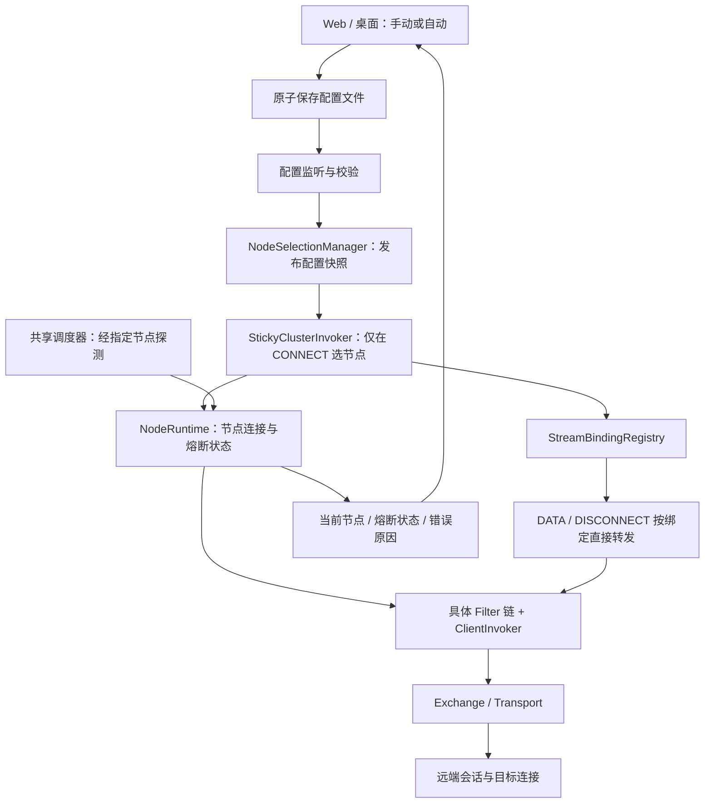
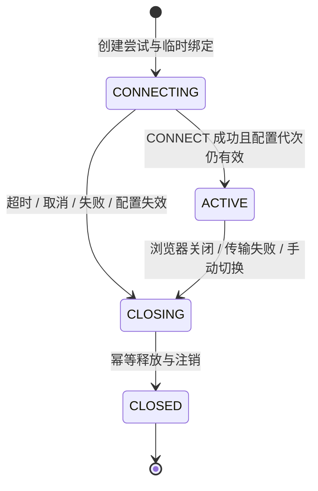

# 节点选择与故障切换改造方案

> **2026-10-22 后续设计：**自动切换以 [P3/P4：自动切换设计与实施验收](http3-auto-failover-p3-p4.md) 为准，尚未实现。本文保留历史讨论；每节点多连接、备用按顺序选择、自动切换保留旧流、额外连接代际及扩大 HTTP/2 自动模式范围等设想，不作为后续实现要求。最新约束为自动模式启动时加载固定节点列表、全部加入 ClusterInvoker、每节点一条预连接、健康候选随机选择；切换仅清理旧 Invoker 的流和连接，恢复不抢回当前节点。自动模式不做节点列表热增删，修改后重启生效。

> **状态：HTTP/3 的 P1、P2 已实现；P3 仍为设计提案。** 已实现范围和验收结果见 [HTTP/3 多节点手动切换：实现与验证](http3-node-selection-p1-p2.md)。本文中的代码现状描述保留为改造前基线；自动故障切换、有限退避、熔断与探测尚未实现，HTTP/2 不在本次改造范围内。
>
> 编写日期：2026-10-20。代码核查基线：`fcd6570`。第一阶段面向 Java `proxy-local`、Web Dashboard 与桌面端的 Java 代理进程；Android 原生 `plane-core` 不在本次实现范围内。

**阅读导航**：先看第 1～3 节了解目标与全貌；第 4～7 节定义运行规则；第 8 节说明配置与界面；第 9～11 节用于实施与验收；第 12 节给出最终使用方式。

相关文档：[总体架构](../ARCHITECTURE.md) · [HTTP/3 传输设计](http3-quic-spi-v1-design.md) · [加密协议 V2](crypto-v2.md) · [项目测试计划](../项目测试计划与清单.md)。本文改变节点选择与生命周期管理，加密协议约定继续沿用原设计。

---

## 1. 设计主张

**让用户决定是否自动切换，让 ClusterInvoker 决定新连接使用哪个节点，让每个流从建立到关闭始终绑定同一个具体 Invoker。**

日常使用固定出口，出现确认的节点故障后才切换。手动更换节点采取立即切换：关闭旧节点的代理连接，后续连接使用新节点。自动模式采用固定首选与故障切换，避免每个流都在多个出口之间轮询。

这套设计接受切换时连接中断的现实，不尝试迁移已建立的 TCP、TLS 或业务会话，也不透明重放业务数据。浏览器刷新或应用重新连接后，建立的是经过新节点的全新连接。

### 1.1 用户最终看到什么

| 模式 | 正常使用 | 节点故障 | 用户主动切换 |
|---|---|---|---|
| 手动选择 | 所有新代理流使用指定节点 | 有限重试后返回错误，不擅自换节点 | 关闭原节点相关流，后续连接使用新节点 |
| 自动故障切换 | 所有新代理流优先使用当前节点 | 达到故障阈值后熔断，新连接选择备用节点 | 更新当前节点，立即断开旧节点相关流 |

自动模式下，故障节点恢复后回到备用列表，**不自动抢回当前节点的位置**。全部节点不可用时及时返回错误，不无限重试，也不回退直连。

### 1.2 连接中断的用户体验

- 网页加载中可能报错、部分资源加载失败，也可能由浏览器自动重试。
- 已加载的页面通常保留；后续请求若需要新连接，则经过新节点。
- 下载、WebSocket、流式响应可能中断，恢复能力由上层应用决定。
- 已提交的业务请求不能由代理擅自重发，避免重复提交。
- 面板固定提示：**“切换节点将断开当前代理连接，部分应用需要刷新或重新连接。”**

固定节点并不保证第三方平台不会触发风控；这里提供的是出口选择可控、连接行为可解释。

## 2. 当前代码：已经有什么，还缺什么

### 2.1 当前调用路径


### 2.2 代码核查结论

| 位置 | 当前行为 | 与目标的差距 |
|---|---|---|
| `proxy-local/.../ProxyLocalServer.java` | 启动时按节点及 `connectionsPerNode` 创建客户端与 Filter 链，再交给集群 | 缺少稳定节点身份、运行时配置快照、节点级资源所有权和热更新协调 |
| `proxy-cluster/.../FailoverClusterInvoker.java` | 每次 `invoke()` 调用负载均衡选 Invoker，异常时换节点重试 | 没有按流固定绑定；异常重试未区分 CONNECT、DATA、DISCONNECT；失败响应也不等于异常 |
| `proxy-local/.../handler/RelayHandler.java` | 保存入口 Invoker，上行 DATA 和 DISCONNECT 继续调用它 | 入口实际是集群，持有同一个集群对象不等于持有同一个具体节点连接 |
| `proxy-local/.../handler/HttpProxyRelayHandler.java` | 普通 HTTP 首包及后续 DATA 通过传入的 Invoker 发送 | 同样需要流绑定，首包只能在 CONNECT 成功后发送一次 |
| `proxy-local/.../handler/StreamChannelRegistry.java` | 保存 `streamId → browserCtx` | 缺少 `streamId → 节点/Invoker/尝试代次`，不能按节点精确批量清理 |
| `proxy-exchange/.../header/ExchangeHandler.java` | 按 streamId 将下行 DATA 写回浏览器 | 需要来源归属校验、流级关闭通知，以及避免旧回调影响新连接 |
| `proxy-exchange/.../header/DefaultFuture.java` | 全局请求表，提供 `failAll()` | 某个连接失败可能影响其他节点的控制请求，需按连接所有权失败处理 |
| `proxy-exchange/.../header/HeaderExchangeClient.java` | DATA 为 fire-and-forget，发送异常记录日志；DISCONNECT 完成后关闭 stream | DATA 返回成功不代表远端收到；异步失败应触发对应流的关闭与健康事件 |
| `proxy-local/.../config/ProxyConfig.java` | 读取启动配置；存在 HTTP/3 V1 单节点限制 | 需要新增模式配置和热加载；多节点 HTTP/3 必须先完成隔离验证 |
| `proxy-remote/.../outbound/SessionManager.java` | 管理目标连接；每 10 秒清理入站 channel 已不活跃的 session | 可复用兜底，但不等于网络黑洞下固定 10 秒内释放，仍需传输失活与超时机制 |
| `dashboard/server.js` | 保存 YAML，向面板广播 `config-changed` SSE | SSE 通知的是面板，不会自动让 Java 进程更新运行时配置 |
| `desktop/src-tauri/src/config.rs` | 当前运行时配置使用单个 `remote`，生成 YAML 时写死集群及负载均衡 | 桌面端需真正保存节点列表与模式，不能只调整页面文字 |

表中省略的 Java 包路径均为各模块的 `src/main/java/com/proxy/`，详细文件清单见第 9 节。

**结论：现有 SPI、Filter、Exchange、Transport 分层可以保留，但只调用 `setInvokers()` 不足以实现安全切换。流绑定与资源清理是这次的核心改造。**

## 3. 改造后的全貌



### 3.1 职责分配

| 组件（新增名称为暂定） | 职责 | 不负责 |
|---|---|---|
| `StickyClusterInvoker` | CONNECT 选节点、有限重试；DATA/DISCONNECT 查绑定；协调流结束 | TCP/TLS 会话迁移、重放业务数据 |
| `NodeSelectionManager` | 手动/自动模式、当前节点、配置版本、切换协调 | 解析 HTTP 业务内容 |
| `NodeRuntime` | 节点 ID、连接代次、具体 Invoker 列表、资源句柄与节点健康 | 持有浏览器 Channel |
| `NodeCircuitBreaker` | CLOSED/OPEN/HALF_OPEN 状态与探测准入 | 为每个节点创建独立线程 |
| `StreamBindingRegistry` | 流与具体 Invoker 的绑定、反向索引、关闭状态 | 通用负载均衡算法 |
| `NodeHealthProbe` | 经指定节点验证代理路径，汇报分类后的结果 | 通过默认集群绕到健康节点来验证故障节点 |
| `NodeConfigWatcher` | 监听外部配置文件、合并重复事件、校验后提交更新 | 直接操作远端目标连接 |

保持单一的浏览器通道注册事实来源：可以扩展现有 `StreamChannelRegistry`，由它组合纯元数据的绑定表；不要再建立一个独立维护的浏览器 Channel 全量副本。集群模块通过小接口访问绑定，不反向依赖 `proxy-local` 或 Netty 浏览器类型。

## 4. 最重要的不变量：一条流，一个具体 Invoker

### 4.1 三层身份必须区分

| 身份 | 含义 | 用途 |
|---|---|---|
| `nodeId` | 用户配置中的稳定逻辑节点 ID | 选择、健康统计、按节点关闭 |
| `connectionId + generation` | 该节点的一条实际隧道及其代次 | 多连接隔离、重连隔离、控制请求所有权 |
| `streamId` | 一次具体建流尝试的唯一标识 | 上下行路由、远端 session 寻址 |

同一节点配置多条连接时，新流可以在**该节点内部**选择连接，选定后整个流固定到具体 Invoker。即使连接自动重建，新连接也不能接续原流，必须使用新 streamId 和新的加密状态。

绑定至少包含：`streamId`、`nodeId`、连接代次、具体节点 Filter 链 Invoker、流状态、配置版本。节点资源关闭通过 `NodeRuntime` 持有的资源句柄执行，不对 Filter 包装对象做强制类型转换。

### 4.2 流生命周期



临时绑定在 CONNECT 发送前注册，确保早到的下行消息有归属；浏览器业务数据暂停读取或有界缓存，成功后才开始转发。并发浏览器请求、提前到达的 TLS 字节和普通 HTTP 首包均需有明确的缓存上限与取消处理。

一次 CONNECT 尝试失败后关闭旧 stream，取消控制请求，清除临时绑定；重试使用全新 streamId。原浏览器握手在总预算内保持等待，不需要为尚未发送的业务数据强制关闭浏览器连接。

DATA 与 DISCONNECT 必须按绑定发送，不能因为节点熔断或已从候选列表移除就改投其他节点。清理消息应绕过“新流准入”检查，否则会出现熔断后无法清理旧流的问题。

普通 HTTP 模式第一阶段保持当前连接级语义：同一浏览器代理连接固定同一远端目标与节点，不增加按每个 HTTP 请求独立选节点的解析能力。HTTPS、WebSocket 等隧道内请求也不逐次参与节点选择。

## 5. 自动模式：固定首选，确认故障后切换

### 5.1 一次新连接如何执行

1. 读取当前配置快照，固定本次尝试所用的节点身份和连接代次。
2. 当前节点可用则使用它；已熔断则选择候选列表中第一个可用备用，并原子更新当前节点。
3. 同一节点内选择一条可用具体连接，分配新 streamId，注册临时绑定，发送 CONNECT。
4. 成功后激活绑定，向浏览器确认握手成功，发送此前保留的业务首包。
5. 可重试失败则清理本次尝试，进行指数退避加随机抖动；只在原节点重试，不在一次请求内遍历所有节点。
6. 本次重试耗尽则向浏览器返回连接失败；健康统计独立更新，达到熔断阈值后切换当前节点，供后续新连接使用。

这与讨论中的交互一致：本次连接可能报错，用户刷新或应用重连后走新节点。浏览器也可能自动发起新连接，不必依赖用户一定点击刷新。

### 5.2 重试与节点故障统计

建议初始参数如下，均为**待实现默认值**，不是现有代码配置或实测最优值。

| 参数 | 初始建议 | 说明 |
|---|---|---|
| 单连接最多尝试 | 3 次，含首次 | 仅建连阶段 |
| 单次 CONNECT 超时 | 3 秒 | 受总预算约束，不能每次都重新获得完整总预算 |
| 总建连预算 | 10 秒 | 包括建连、退避与排队，超时或浏览器关闭即取消 |
| 退避 | `random(0, min(1000ms, 200ms × 2^retryIndex))` | full jitter；用调度器实现，禁止阻塞 EventLoop |
| 熔断阈值 | 连续 3 次合格的节点连接失败 | 同一个事件只计一次；目标网站错误不计入 |
| 熔断后探测间隔 | 30 秒，附少量随机抖动 | 共享调度器，限制全局并发 |
| 恢复条件 | 连续 2 次探测成功 | 半开期间仅允许受控探测，失败重新打开 |

高并发下故障统计属于节点共享状态，不能让每个流各维护一个熔断器。连接级故障只按实际故障事件记录一次，不能因为它同时影响 100 个流就重复计数 100 次。成功事件也要绑定连接代次，不能让旧尝试的迟到成功把新故障清零。

### 5.3 哪些失败能让节点熔断

| 结果 | 处理 |
|---|---|
| 到代理节点的连接拒绝、握手超时、确认的连接级传输故障 | 计入节点故障；连接死亡时关闭其绑定流 |
| CONNECT 等待响应超时，原因尚不明确 | 关闭该尝试并触发节点探测；单独记录，不能直接等同目标或节点故障 |
| 目标网站连接拒绝、DNS 失败、目标连接超时 | 返回目标错误，不据此熔断整个节点 |
| 浏览器取消、手动切换、代理本机限流或本地队列满 | 不计节点故障，不重试被取消的任务 |
| 密钥错误、证书校验失败、协议不兼容 | 禁用该节点并显示配置错误；修正配置后再试，不靠循环退避恢复 |
| 空闲业务连接一段时间没有数据 | 不能据此判断节点故障 |

现有 `Response.error()` 的字符串及通用超时不能可靠表达所有这些类别。实施时需增加最小的错误类别：本地连接异常分类；必要时由远端在现有响应内容中提供目标连接错误标识，保持老端未提供标识时按 UNKNOWN 处理。禁止靠匹配日志文案决定熔断。

### 5.4 熔断与清理分开

**熔断决定能不能接收新流，连接生命周期决定已有流是否需要关闭。**

- 只是新建连接连续失败：停止新流准入，健康的已有流可以继续。
- 具体隧道已经断开：关闭绑定到该隧道的所有浏览器流，其他隧道不受影响。
- 用户主动立即切换：关闭旧节点全部代理流及相关客户端连接。
- 所有节点不可用：立即返回“无可用节点”，不制造重试风暴。

### 5.5 探测必须验证指定代理路径

探测通过被检查节点的独立 stream 连接 HTTPS 测试站点，校验证书与预期状态码，设置总超时及响应大小上限。不能在本机直接 curl，也不能经 `ClusterInvoker` 自动绕到其他节点。可以复用现有隧道协议实现有界探测客户端，不强制依赖系统 curl 进程。

传输层探活验证“能否到节点”，HTTPS 探测验证“节点能否完成到外网的代理链路”，两类结果分别记录。单个测试站点失效不能永久封死所有节点，可使用小规模备用测试地址复核。探测成功只恢复候选资格，不迁移已有流、不自动切回首选。

## 6. 手动模式与配置热更新

### 6.1 手动模式并不需要另一套通信链

候选视图只保留用户选中的一个逻辑节点，其内部仍可有多条连接；其他配置节点保留在配置中。固定选择、流绑定和清理复用自动模式的同一套机制，关闭自动故障换节点能力即可。

手动节点失败时有限重试并报错，绝不偷偷使用其他节点。健康探测只用于展示和恢复判断，不能改变用户选定节点。

### 6.2 立即切换的执行顺序

1. 校验新配置，构造新快照；新节点身份、端口、传输和加密配置合法后再进入切换。
2. 在切换协调器内暂停受影响代理流的新建准入，配置版本递增，旧节点标记 RETIRING；不关闭本地监听端口。
3. 取消旧版本正在等待的 CONNECT、退避任务，收集旧节点已绑定的浏览器流。
4. 清理器通过每条流原绑定的 Invoker 尽力发送 DISCONNECT；不等待无限期的远端确认。
5. 在对应 EventLoop 关闭旧浏览器连接和传输 stream，幂等注销映射、取消 Future；关闭旧节点客户端并停止其后台重连任务。
6. 原子发布新节点视图，恢复代理流准入，发布运行时应用结果；后续连接只使用新节点。

候选节点可以提前预热，但预热不是提交配置的必要条件：用户明确选择一个暂时不可达的新节点时，可以完成切换并显示“已应用，节点不可用”，不能悄悄回到旧节点。配置本身非法则拒绝应用，保留原运行时状态。

切换前后不得有旧 CONNECT 成功回调重新注册流；回调必须检查配置版本、连接代次和流状态。准入暂停期间的新请求快速失败或在有界总预算内等待，不能继续进入旧节点。直连流不属于旧 Invoker，保持原路由规则，不应被批量关闭。

### 6.3 配置如何到达 Java 运行时

第一阶段建议复用配置文件作为跨进程载体：Dashboard/桌面写入临时文件后原子替换，Java 监听外部配置文件变化，防抖、重新解析、完整校验，然后提交给切换协调器。

监听器需要处理重复通知、原子替换造成的文件重新注册及遗漏事件，可用低频版本/摘要复查兜底。运行在 classpath 内的默认资源无法当作可写热更新文件；启动脚本必须把运行时外部配置路径显式传入。

面板必须区别“已保存”与“运行时已应用”。建议 Java 在仅本机可读的状态文件原子发布 `appliedRevision`、当前节点与错误，Dashboard 和桌面读取该状态确认；状态文件不包含密钥。SSE 可以继续用于面板状态通知，但它不是 Java 配置订阅总线。

第一阶段仅热更新节点选择、候选节点及其连接参数。监听端口、系统代理或 TUN 路由等变化继续要求相应服务重启/重新配置，并明确告知用户，不能显示成节点切换已经覆盖一切。

## 7. 下行路由、Future 与远端清理

### 7.1 Exchange 层隔离

实际类名为 `ExchangeHandler`。它继续负责按 streamId 写回浏览器，同时补充：

- 校验下行消息来自绑定的连接代次；旧 stream 回调只能清理自己。
- 流关闭只失败对应 stream 的请求；父连接关闭只失败该连接拥有的请求。
- `DefaultFuture` 注册时记录连接所有者与 streamId，新增按所有者、按流取消能力；全局 `failAll()` 仅用于进程整体停机。
- 保持 requestId 全局唯一，但请求失败的作用域必须缩小。
- DATA 的“本地已接收发送”不能冒充远端投递确认；传输异步写失败通过生命周期回调关闭绑定流，不增加每帧业务 ACK。

### 7.2 一次关闭应该释放什么

| 资源 | 释放方式 |
|---|---|
| 浏览器 Channel | 在其 EventLoop 关闭，触发入口清理 |
| stream 绑定与节点反向索引 | 原子进入 CLOSING，幂等删除 |
| CONNECT / DISCONNECT Future | 按流或连接取消，同时取消超时任务 |
| HTTP/2 / HTTP/3 stream | 关闭或 reset，释放待发送数据与加密实例 |
| 远端 OutboundSession 与目标 TCP | 优先 DISCONNECT；传输关闭事件和远端兜底清理补充 |
| 节点连接、预热与重连任务 | 手动移除或切换时释放；自动熔断恢复所需任务由节点生命周期统一管理 |

网络已经不可达时无法保证 DISCONNECT 到达，远端当前“入站 channel 不活跃后每 10 秒扫描”可以复用，但黑洞状态要先被传输空闲/连接超时识别。不能承诺所有故障都能立即关闭远端 socket，也不要用过短的业务空闲超时误杀正常长连接。

关闭操作必须幂等，浏览器 `channelInactive`、远端 DISCONNECT、手动切换与传输异常可以同时到达。关闭期间要允许原绑定执行清理，不能在移除绑定后又经集群重新选择节点发送 DISCONNECT。

## 8. 配置与面板设计

### 8.1 拟议配置形状

以下只是新增字段的设计示例，**不能直接复制到当前版本使用**。现有节点的 cipher、TLS 和 HTTP/3 详细字段继续沿用，示例省略密钥。

```yaml
remoteServers:
  - id: node-a
    name: 主节点
    host: node-a.example.com
    port: 9090
    transport: http2
  - id: node-b
    name: 备用节点
    host: node-b.example.com
    port: 9090
    transport: http2

nodeSelection:
  mode: auto                 # manual | auto
  selectedNodeId: node-a     # manual 使用；auto 冷启动的初始首选
  candidateNodeIds: [node-a, node-b]
  retry:
    maxAttempts: 3
    attemptTimeoutMs: 3000
    totalTimeoutMs: 10000
    baseDelayMs: 200
    maxDelayMs: 1000
  circuitBreaker:
    failureThreshold: 3
    probeIntervalMs: 30000
    recoverySuccessThreshold: 2
  healthCheck:
    urls: [https://www.gstatic.com/generate_204]
    expectedStatus: 204
    timeoutMs: 5000
```

`selectedNodeId` 是用户配置，`currentNodeId` 是运行时状态；自动故障切换不反复改写用户配置文件。自动模式重启后第一阶段重新从配置首选开始判断，不恢复历史会话。`id` 必须唯一且稳定；地址、传输、密钥改变时保留逻辑 ID，但创建新连接代次并按受影响节点执行立即切换。

兼容旧配置时：单节点迁移为手动模式；多节点生成稳定 ID，迁移为自动固定首选，并明确提示行为变化。不能仅把旧 `cluster/loadBalance` 藏起来却继续每个 DATA 做轮询。新配置存在时由节点选择语义主导，旧字段保留读取兼容并提示弃用；无效节点 ID、空候选列表与矛盾配置在应用前拒绝。

### 8.2 面板布局

```text
节点连接
  模式： [手动选择] [自动故障切换]
  当前节点：主节点        状态：可用        活跃流：12

  手动：节点下拉列表  [应用并切换]
  自动：有序候选节点列表 + 当前生效节点

  高级设置（仅自动模式展开）
    重试次数 / 超时 / 熔断阈值 / 健康检查

  提示：切换节点将断开当前代理连接。
  状态：已保存版本 8 / 运行时已应用版本 8
```

现有集群策略、负载均衡入口从首页收起。第一阶段自动模式固定为粘性故障切换，**不让 forking、failback 或跨节点 round-robin 成为隧道数据的可选执行路径**。旧 SPI 实现保留作扩展和兼容，但新模式不走这些危险组合。

同一节点内部的多连接分配可以复用现有 LoadBalance；跨节点按流负载均衡属于后续显式扩展，不默认开启。无需为尚未实现的高级策略展示可点击选项。

Web Dashboard 与桌面端使用同一配置语义。桌面端当前运行配置为单 `remote`，需要迁移成节点集合及选择配置，并保证导入节点、保存配置与生成 Java YAML 全链路一致。

## 9. 具体代码改动清单

以下是实施计划，不是已修改文件列表。Java 路径以模块目录为根。

| 模块 / 文件 | 计划改动 |
|---|---|
| `proxy-common/src/main/java/com/proxy/common/cluster/ClusterInvoker.java` | 保留 SPI；增加最小配置/选择协作契约或独立接口，避免向通用 Invoker 塞浏览器生命周期 |
| `proxy-common/.../cluster/`（新增） | 纯元数据的节点身份、绑定访问及生命周期回调契约；不得依赖 proxy-local |
| `proxy-common/.../filter/Response.java` | 必要时补充可兼容的错误分类标识，区分目标错误、节点错误、取消与配置错误 |
| `proxy-cluster/.../StickyClusterInvoker.java`（新增） | CONNECT 固定首选与有限重试；DATA/DISCONNECT 严格查绑定 |
| `proxy-cluster/.../node/`（新增） | `NodeSelectionManager`、`NodeRuntime`、`NodeCircuitBreaker`、共享探测调度与纯元数据绑定管理 |
| `proxy-cluster/src/main/resources/META-INF/proxy/com.proxy.common.cluster.ClusterInvoker` | 注册新粘性策略；不改变既有 SPI 文件机制 |
| `proxy-cluster/.../FailoverClusterInvoker.java` 及其他旧集群实现 | 明确旧语义与适用边界；不能再作为新隧道模式的数据重试入口 |
| `proxy-cluster/.../ClientInvoker.java` | 节点/连接所有权与生命周期协作；保留现有 DATA 快路径；提供真实写失败事件 |
| `proxy-local/.../ProxyLocalServer.java` | 节点运行时装配、依赖注入、配置监听启动/关闭、状态快照；有状态集群用独立 SPI 实例，避免缓存实例串状态 |
| `proxy-local/.../config/ProxyConfig.java` | 模式、稳定 ID、重试与熔断配置，迁移及校验；HTTP/3 限制按验证阶段调整 |
| `proxy-local/.../config/NodeConfigWatcher.java`（新增） | 外部文件热加载、防抖、失败保留原快照、版本发布 |
| `proxy-local/.../handler/StreamChannelRegistry.java` | 集成绑定元数据与节点反向索引，提供按节点/连接关闭能力，保留既有下行映射兼容 |
| `proxy-local/.../handler/HttpConnectHandler.java` | CONNECT 尝试、取消与首包处理；只在绑定激活后回应成功 |
| `proxy-local/.../handler/Socks5ConnectHandler.java` | 同上，保持 SOCKS5 握手错误语义 |
| `proxy-local/.../handler/RelayHandler.java` | DATA 与关闭使用固定绑定；异常关闭，不重新选节点 |
| `proxy-local/.../handler/HttpProxyRelayHandler.java` | 普通 HTTP 首包只发一次，后续数据及关闭沿用绑定 |
| `proxy-exchange/.../header/DefaultFuture.java` | 按连接/stream 所有权取消；全局清理仅用于整体停机 |
| `proxy-exchange/.../header/HeaderExchangeClient.java` | 注册 Future 所有权，取消与关闭协作，发送失败通知 |
| `proxy-exchange/.../header/ExchangeHandler.java` | 来源归属、连接与流生命周期分开处理，避免跨节点 failAll |
| `proxy-common/.../exchange/ExchangeClient.java`、`transport/Client.java`、`transport/MessageHandler.java` | 按需要补充小型生命周期/写失败契约；保持具体 Transport 细节在传输模块 |
| `proxy-transport-netty/.../NettyClient.java` | 连接与流级事件、重连代次、定向失败清理与取消，保持帧重组和背压 |
| `proxy-transport-http3/.../Http3Client.java`、`Http3Connection.java`、流 Handler | 验证多客户端隔离、关闭/reset、迟到回调、连接代次与队列释放 |
| `proxy-remote/.../dispatch/DispatchInvoker.java` | 核对 CONNECT 错误分类、DISCONNECT 幂等与关闭中的迟到 CONNECT |
| `proxy-remote/.../outbound/SessionManager.java`、`OutboundSession.java` | 复用现有 session；必要时补充入站关闭回调、幂等释放，保留定期兜底 |
| `proxy-local/src/main/resources/proxy.yml` | 新配置示例、迁移说明，不单方面更改现有加密套件 |
| `dashboard/server.js`、`dashboard/yaml.js` | 原子保存、配置校验、节点状态与 appliedRevision，兼容旧配置 |
| `dashboard/public/index.html`、`app.js`、`style.css` | 模式切换、节点选择、自动高级设置、立即切换提示与真实应用状态 |
| `desktop/web/index.html`、`app.js`、`style.css` | 与 Web 相同交互语义，避免保存节点列表但实际仍只使用一个 remote |
| `desktop/src-tauri/src/config.rs`、`commands.rs` | 配置迁移、节点集合、运行时 YAML 生成与应用状态读取 |
| `README.md`、`docs/桌面端使用说明与故障排查.md`、`dashboard/FRONTEND.md`、`BACKEND.md` | 实施完成后同步模式说明、中断预期、故障定位和配置示例 |

本次不重构加解密实现、不改代理数据帧格式、不引入通用事件总线。若补充错误分类沿用现有响应承载能力，并以新旧端互通测试确认兼容。LogLens 不参与节点选择；可以复用现有日志记录切换与熔断事件。

## 10. 实施顺序与发布门槛

| 阶段 | 交付内容 | 放行条件 |
|---|---|---|
| P1：流绑定与隔离 | CONNECT 绑定、DATA 定向、幂等关闭、Future 按所有者隔离 | 多节点并发流不串路；单节点故障不影响其他节点 |
| P2：手动立即切换 | 稳定节点 ID、配置快照、监听器、按节点关闭与应用状态 | 切换无需重启 Java 进程；旧流全部关闭，新流只走新节点 |
| P3：自动故障切换 | 固定首选、有限退避、共享节点熔断、定向探测 | 故障达到阈值后新连接切备用；无业务重放与自动切回 |
| P4：传输与客户端整合 | HTTP/2、HTTP/3 回归，Web/桌面模式与配置迁移 | 完整矩阵通过后再开放面板多节点能力 |

HTTP/3 当前校验明确要求一个节点和一条连接：**不能直接删掉校验作为支持多节点的实现。** 先验证两个独立 Http3Client 的握手、stream 状态、密钥实例、队列、Future 与关闭隔离，再调整限制。同样检查 TUN 对代理节点 IP 的直连豁免：候选节点及探测流不能被重新送回代理形成回环。节点地址变化涉及 TUN/DNS/路由重配置时，必须明确该部分的应用状态或重启要求。

部署顺序先验证并发布安全绑定，再开启多节点。已有线上服务与节点配置不因本文变更；实施测试使用独立节点/端口，不中断当前工作连接。

## 11. 验收矩阵

| 场景 | 必须满足的结果 |
|---|---|
| A/B 并发流与大量分片 | 每个流固定节点和具体连接，字节比对一致，无串流、重复或缺失 |
| 同节点两条连接 | 仅建流时选连接；一条连接失败不清理另一条连接 |
| CONNECT 超时后重试 | 新 streamId、新请求 ID；旧绑定及远端迟到会话最终清理 |
| 已发送 DATA 后节点失败 | 关闭原流，不向 B 重放 DATA |
| 目标网站单独失败 | 返回目标错误，不熔断健康节点 |
| A 熔断而旧流仍健康 | 新流转 B，健康旧流继续留 A |
| A 连接彻底失效 | 定向关闭对应浏览器流，B 的流和控制 Future 正常 |
| 手动 A → B | 旧 A 代理流断开；切换提交后无新流进入 A；直连流不受影响 |
| 连续 A → B → C 与迟到回调 | 最终版本是 C；旧回调不能激活已取消流或关闭 C 的流 |
| 重试等待中浏览器关闭 | 取消退避、Future、临时绑定，禁止后台继续建流 |
| 半开状态并发请求 | 探测准入有上限，业务请求不压垮恢复节点 |
| A 恢复 | 回到备用，不主动把 B 的新流切回 A |
| 全部节点不可用 | 有界时间失败，不回退直连、不无限创建任务 |
| DISCONNECT 丢失/重复/网络黑洞 | 本地幂等清理，远端在失活检测及兜底期限内释放资源 |
| 配置保存但运行时校验失败 | UI 明确显示未应用，原有效快照保留 |
| 配置文件原子替换及重复事件 | 同一版本仅应用一次，监听持续有效 |
| 旧 YAML 与桌面旧配置迁移 | 节点、密钥、路由规则保留，新增模式行为明确可见 |
| HTTP/2 与 HTTP/3、多节点混合 | 各客户端连接状态和加密实例隔离，关闭一端不影响另一端 |

验证分三层：纯状态机及虚拟时钟测试覆盖重试/熔断；真实 Handler/Transport 集成测试覆盖流绑定与关闭；两个真实代理节点加可控目标服务覆盖刷新重连与数据完整性。故障注入至少包括拒绝连接、延迟、丢弃报文、父连接断开和响应晚到。

性能验证关注 DATA 路径新增查表开销、内存与清理时间，不为了控制面改造加入每帧锁竞争、阻塞探测或业务 ACK。切换反复执行后，绑定数、待完成 Future、待发送字节与节点重连任务都应回落到合理基线。具体吞吐与清理时间以实施后的测量为准，本文不提供尚未测试的性能承诺。

## 12. 完成后的使用方式

**只想用一个节点：** 选择手动模式，选中节点后应用。节点异常就显示错误；更换节点时旧连接断开，刷新页面或让应用重连即可。

**希望节点坏了自动换：** 选择自动故障切换，配置有序候选节点。平时固定一个出口，故障确认后后续连接走备用。正在失败的请求可能仍需刷新，已有业务流不会被透明迁移。

**排查问题：** 面板先看“当前生效节点”和“配置是否已应用”，再看失败类别、熔断状态、最后探测时间与切换原因。日志应记录节点 ID、连接代次、streamId 和配置版本，密钥与敏感业务内容不进入状态事件。

这次改造的验收目标是：**节点选择可控、流绑定稳定、故障作用域准确、切换能清理资源、面板展示与实际运行一致。**
