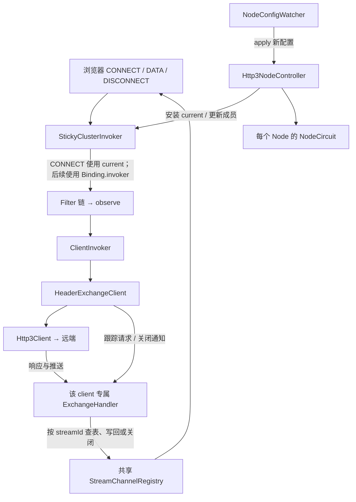
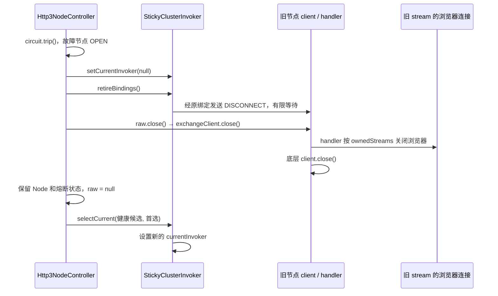

# 节点切换：作者原始设计提示词与源码逐项对应

本文保存作者对手动选点、自动故障切换及两种模式互切的原始设计说明，并将其中每个关键动作对应到实际源码。正文沿用作者的思路和叙述顺序，不另起一套设计。

核对日期：2026-10-25。源码基线：`bd25489e3a541b30109e7c5118d90a0e78eb21b4`。下文讨论配置启用 `nodeSelection` 的 HTTP/3 节点选择路径；未启用该配置时的传统 Cluster SPI 路径不属于本文范围。原始实现的带行号链接固定到该提交，第 3.4 节源码链接固定到 `e94a2c2`；第 3.5 节使用仓库相对路径定位本轮实现，避免用当前源码冒充历史版本。

第 3.4、3.5 节分别记录作者后续提出的 current-only 调用及移除 cluster 绑定管理的调整。其余原始代码摘录保留上述历史基线，便于区分最初实现和后续调整。第 3.4 节的测试结果对应提交 `e94a2c2`；第 3.5 节另行记录本轮结果。

原始提示词是本次对话中由作者回述的实现设计，本文不将它描述为具有独立历史存档证据的早期提示词。代码摘录来自对应版本的实际实现；时序图是对调用顺序的整理。第 9 节保留最初核对时的测试源码说明，本次代码调整的实际测试执行结果另见第 3.4 节。

## 1. 作者原始提示词

以下完整保留作者的原话，只按叙述主题分段，保留原有口语、拼写和判断。后文单独说明口述与实现细节的差别，不在引文里改写作者的设计。

> 这个项目我跟你说一下当前的架构吧，首先就是手动模式，手动模式情况下，这个clusterinvoker基本只有currentinvoker有用，invoke方法的逻辑大概就是先看一下是不是连接事件，是的话看看当前currentinvoker是否为空，是否可用（有点多余，因为这个只有在自动模式下有熔断器的时候才会出现）以及为空的话需要负载均衡选一个，但是手动模式下只有一个节点，启动的时候会读取配置直接注入到clusterinvoker中并且给currentinvoker赋值，切换到其他节点的时候会更新clusterinvoker中的invoker并且给currentinvoker赋值，不赋值也无所谓，负载均衡选择就行了，负载均衡选完之后更新currentinvoker就行，然后就是下一步就是让这个streamid和当前invoker绑定对应的关系，然后就去建立连接，如果是其他的事件，比如data，disconnect这些的话，那就直接根据streamid找到对应的invoker，其实就是currentinvoker嘛，发送数据，然后就是经过exchangclient，exchangehandler，最后发送出去。。。。。
>
> 主要是讲一下这个手动切换，自动切换，手动切自动，自动切换手动分别的思路。。。手动切换的时候，就是监听器监听到这个配置发生了变化，然后先将currentinvoker设置为null，从cluster移除这个invoker，然后通过exchangehandler记录的这个invoker的活跃的streamid，关闭浏览器连接，然后client调用close方法，关闭和远端的连接，然后创建这个新节点的invoker，设置currentinvoker，并且添加这个invoker。
>
> 自动切换就比较麻烦了，首先就是首选节点和其他节点，这些节点初始化成一个个invoker并且加入到cluster，cluster中的currentinvoker也设置成首选节点，之后就是同理使用这个invoker发送数据，但是唯一不同的地方就是每个invoker背后的熔断器会根据invoker的表现情况决定是否熔断，一旦熔断之后，先将currentinvoker设置为null，不会移除invoker的，然后通过exchangehandler记录的这个invoker的活跃的streamid，关闭浏览器连接，然后client调用close方法，关闭和远端的连接，等待下一次自己负载均衡从健康节点集合中选择健康的节点，也不存在会误伤新invoker的连接的情况，因为stream都是明知的，然后更新currentinvoker，背后的熔断器会决定何时放回到健康节点集合当中。这是自动切换的思路，
>
> 然后自动切换手动，currentinvoker设置为null，断开旧invoker的所有连接，移除invoker，添加手动选择的invoker并且设置currentinvoker，手动便自动也是同理。大概就是这样子

## 2. 这段设计里的对象，对应哪些代码

作者说的 `clusterinvoker`，在本文涉及的运行路径中就是 `StickyClusterInvoker`。入口由 [ProxyLocalServer.buildInvokerChain()](https://github.com/zhh293/SimplePlanePlatform/blob/bd25489e3a541b30109e7c5118d90a0e78eb21b4/proxy-local/src/main/java/com/proxy/local/ProxyLocalServer.java#L104) 明确选择：存在 `nodeSelection` 就构造 `Http3NodeController`，并将 `controller.getClusterInvoker()` 交给业务 Handler。控制器直接持有 `new StickyClusterInvoker()`，不依赖 SPI 配置文件决定这个实现。

| 作者的概念 | 实际对象／字段 | 对应职责与源码 |
| --- | --- | --- |
| cluster 与当前 invoker | `StickyClusterInvoker.invokers`、`currentInvoker` | 保存成员和当前业务选点；[字段及 Binding 定义](https://github.com/zhh293/SimplePlanePlatform/blob/bd25489e3a541b30109e7c5118d90a0e78eb21b4/proxy-cluster/src/main/java/com/proxy/cluster/StickyClusterInvoker.java#L17) |
| streamId 与 invoker 绑定 | `bindings: ConcurrentHashMap<Long, Binding>` | `Binding.invoker` 固定保存 CONNECT 当时选定的调用器，另存目标地址及 active 状态；[invoke()](https://github.com/zhh293/SimplePlanePlatform/blob/bd25489e3a541b30109e7c5118d90a0e78eb21b4/proxy-cluster/src/main/java/com/proxy/cluster/StickyClusterInvoker.java#L37) |
| 节点的 invoker | `Node.raw`、`Node.wrapped` | raw 是 `ClientInvoker`；wrapped 是 Filter 链包装后的调用器，放进 cluster 并用于业务绑定；[Node 定义](https://github.com/zhh293/SimplePlanePlatform/blob/bd25489e3a541b30109e7c5118d90a0e78eb21b4/proxy-local/src/main/java/com/proxy/local/config/Http3NodeController.java#L24)、[beginConnect()](https://github.com/zhh293/SimplePlanePlatform/blob/bd25489e3a541b30109e7c5118d90a0e78eb21b4/proxy-local/src/main/java/com/proxy/local/config/Http3NodeController.java#L142) |
| 每个节点背后的熔断器 | `Node.circuit: NodeCircuit` | 由控制器观察调用结果、连接状态和探测响应并更新；[observe()](https://github.com/zhh293/SimplePlanePlatform/blob/bd25489e3a541b30109e7c5118d90a0e78eb21b4/proxy-local/src/main/java/com/proxy/local/config/Http3NodeController.java#L195)、[NodeCircuit](https://github.com/zhh293/SimplePlanePlatform/blob/bd25489e3a541b30109e7c5118d90a0e78eb21b4/proxy-local/src/main/java/com/proxy/local/config/NodeCircuit.java#L4) |
| 配置变化监听器 | `NodeConfigWatcher` | 每 500ms 检查文件摘要，校验新配置，再调用 `controller.apply(next)`；[poll()](https://github.com/zhh293/SimplePlanePlatform/blob/bd25489e3a541b30109e7c5118d90a0e78eb21b4/proxy-local/src/main/java/com/proxy/local/config/NodeConfigWatcher.java#L50) |
| ExchangeClient | `HeaderExchangeClient` | 控制面 request、数据面 send、关闭连接；[request()](https://github.com/zhh293/SimplePlanePlatform/blob/bd25489e3a541b30109e7c5118d90a0e78eb21b4/proxy-exchange/src/main/java/com/proxy/exchange/header/HeaderExchangeClient.java#L44) |
| ExchangeHandler 记录的 stream | `ownedStreams`、`pendingRequests` | 前者记录这个 handler 所属 client 的 stream，后者跟踪未完成的控制面请求；[trackRequest()](https://github.com/zhh293/SimplePlanePlatform/blob/bd25489e3a541b30109e7c5118d90a0e78eb21b4/proxy-exchange/src/main/java/com/proxy/exchange/header/ExchangeHandler.java#L87) |
| stream 对应的浏览器连接 | `StreamChannelRegistry.registry` | 共享的 `streamId → ChannelHandlerContext` 表，负责回包寻址及关闭浏览器；[register()](https://github.com/zhh293/SimplePlanePlatform/blob/bd25489e3a541b30109e7c5118d90a0e78eb21b4/proxy-local/src/main/java/com/proxy/local/handler/StreamChannelRegistry.java#L72) |

对象关系如下。业务 Handler 保存的是 cluster 入口，具体节点由 cluster 内的选择与绑定决定。



`HeaderExchanger.connect()` 每次创建一个新的 `ExchangeHandler`，把它传给底层 transporter，再与返回的 client 一起封装成 `HeaderExchangeClient`。因此，浏览器路由表虽然共享，`ownedStreams` 和 `pendingRequests` 却属于各自的 handler。这正是作者所说“知道旧 invoker 有哪些 stream”的实际结构。[源码：HeaderExchanger.connect()](https://github.com/zhh293/SimplePlanePlatform/blob/bd25489e3a541b30109e7c5118d90a0e78eb21b4/proxy-exchange/src/main/java/com/proxy/exchange/header/HeaderExchanger.java#L46)

## 3. 手动模式：启动选中节点，再固定使用 currentInvoker

### 3.1 启动时只连接手动选中的节点

`Http3NodeController` 构造时先设置随机负载均衡实现、清空 current，再执行 `initialize(config)`；手动模式还会等待 `manualReady`。初始化期间，配置里可以有多个节点，但实际只连接 `selectedNodeId` 对应的那个。

[源码：initialize()](https://github.com/zhh293/SimplePlanePlatform/blob/bd25489e3a541b30109e7c5118d90a0e78eb21b4/proxy-local/src/main/java/com/proxy/local/config/Http3NodeController.java#L126) 的实际筛选条件：

```java
        for (ProxyConfig.RemoteServer remote : config.getRemoteServers()) {
            if (automatic() || remote.getId().equals(currentNodeId)) {
                Node node = new Node(remote);
                nodes.put(remote.getId(), node);
                beginConnect(node);
            }
        }
```

连接成功后的 `beginConnect()` 依次完成：

1. 注入共享的浏览器 stream 路由表和 `cluster::unbind` 关闭回调。
2. 创建 `ClientInvoker`，构造经过 Filter 链的 `node.wrapped`。
3. `refreshMembers()` 把已创建的 wrapped 放进 cluster。
4. 手动模式执行 `cluster.setCurrentInvoker(node.wrapped)`，更新节点状态。

这对应作者说的“启动读取配置，注入 cluster，给 currentInvoker 赋值”。实际顺序是**先成为 cluster 成员，再设置 current**，因为 `setCurrentInvoker()` 会拒绝非成员调用器。[源码：beginConnect()](https://github.com/zhh293/SimplePlanePlatform/blob/bd25489e3a541b30109e7c5118d90a0e78eb21b4/proxy-local/src/main/java/com/proxy/local/config/Http3NodeController.java#L172)、[setCurrentInvoker()](https://github.com/zhh293/SimplePlanePlatform/blob/bd25489e3a541b30109e7c5118d90a0e78eb21b4/proxy-cluster/src/main/java/com/proxy/cluster/StickyClusterInvoker.java#L108)

### 3.2 CONNECT：检查 current，再绑定 stream，再调用节点

[StickyClusterInvoker.invoke()](https://github.com/zhh293/SimplePlanePlatform/blob/bd25489e3a541b30109e7c5118d90a0e78eb21b4/proxy-cluster/src/main/java/com/proxy/cluster/StickyClusterInvoker.java#L37) 先校验 streamId。遇到 CONNECT 时进入同步块，计算当前可用成员，选择具体 invoker，并在调用节点之前建立绑定：

```java
                List<Invoker> available = getAvailableInvokers();
                if (available.isEmpty()) return error("No available invoker");
                Invoker selected = fixedSelection ? currentInvoker : loadBalance == null ? available.get(0)
                        : loadBalance.select(available, invocation, Collections.emptySet());
                if (selected == null || !available.contains(selected)) return error("Current node unavailable");
                Binding binding = new Binding(selected, invocation);
                if (bindings.putIfAbsent(streamId, binding) != null) return error("Stream already bound");
```

后续执行 `selected.invoke(invocation)`。成功响应返回且绑定仍然是原来的 `binding` 时，才设置 `binding.active = true`；失败、异常或已被取消时清理绑定。因此“先绑定，再建立目标连接”确实落实在代码中，且绑定包含正在建立、尚未 active 的 stream。

这里的 CONNECT 指通过已建立的节点 client，请求远端连接目标网站。节点侧 HTTP/3 client 本身由控制器预先创建，不能把两次建连混为一谈。[业务入口：HttpConnectHandler](https://github.com/zhh293/SimplePlanePlatform/blob/bd25489e3a541b30109e7c5118d90a0e78eb21b4/proxy-local/src/main/java/com/proxy/local/handler/HttpConnectHandler.java#L168)、[SOCKS5 入口](https://github.com/zhh293/SimplePlanePlatform/blob/bd25489e3a541b30109e7c5118d90a0e78eb21b4/proxy-local/src/main/java/com/proxy/local/handler/Socks5ConnectHandler.java#L169)

### 3.3 DATA、DISCONNECT：查原绑定，不重新选择节点

作者说“根据 streamId 找到对应 invoker，其实就是 currentInvoker”，准确表达了稳定运行时的关系；源码保存的是当时选中的 invoker 引用，因此切换期间也不会因 current 改变而把旧数据发给新节点。

`invoke()` 的非 CONNECT 分支读取 `bindings.get(streamId)`；没有绑定就报错。DISCONNECT 先移除绑定，再调用原 invoker；DATA 必须已有 active 绑定，才转给原 invoker。该分支不执行负载均衡。[源码：非 CONNECT 分支](https://github.com/zhh293/SimplePlanePlatform/blob/bd25489e3a541b30109e7c5118d90a0e78eb21b4/proxy-cluster/src/main/java/com/proxy/cluster/StickyClusterInvoker.java#L72)

`RelayHandler` 为 DATA 和 DISCONNECT 带上原来的 streamId，并继续调用 cluster；关闭浏览器时还注销浏览器路由表。[源码：RelayHandler](https://github.com/zhh293/SimplePlanePlatform/blob/bd25489e3a541b30109e7c5118d90a0e78eb21b4/proxy-local/src/main/java/com/proxy/local/handler/RelayHandler.java#L63)

发送和接收分别是：

```text
上行 CONNECT / DISCONNECT：
业务 Handler → StickyClusterInvoker → Binding 对应的 wrapped
  → Filter 链 → observe → ClientInvoker.invoke
  → HeaderExchangeClient.request → 底层 client.send → 远端

上行 DATA：
RelayHandler → StickyClusterInvoker → Binding.invoker
  → Filter 链 → observe → ClientInvoker.invoke
  → HeaderExchangeClient.send → 底层 client.send → 远端

下行响应 / DATA / DISCONNECT：
底层传输 pipeline → ExchangeHandler
  → 控制面：按 requestId 完成 DefaultFuture
  → 数据面：按 streamId 查浏览器路由表，写回数据或关闭浏览器
```

作者口述“经过 exchangeclient、exchangehandler、最后发送出去”描述的是交换层协作。实际发送调用直接从 `HeaderExchangeClient` 进入底层 `client.send()`；`ExchangeHandler` 负责请求跟踪、响应、推送和关闭回调，并非每次上行发送都串行调用它的 `channelRead0()`。[源码：ClientInvoker.invoke()](https://github.com/zhh293/SimplePlanePlatform/blob/bd25489e3a541b30109e7c5118d90a0e78eb21b4/proxy-cluster/src/main/java/com/proxy/cluster/ClientInvoker.java#L39)、[HeaderExchangeClient](https://github.com/zhh293/SimplePlanePlatform/blob/bd25489e3a541b30109e7c5118d90a0e78eb21b4/proxy-exchange/src/main/java/com/proxy/exchange/header/HeaderExchangeClient.java#L44)、[ExchangeHandler.channelRead0()](https://github.com/zhh293/SimplePlanePlatform/blob/bd25489e3a541b30109e7c5118d90a0e78eb21b4/proxy-exchange/src/main/java/com/proxy/exchange/header/ExchangeHandler.java#L122)、[Http3Client.send()](https://github.com/zhh293/SimplePlanePlatform/blob/bd25489e3a541b30109e7c5118d90a0e78eb21b4/proxy-transport-http3/src/main/java/com/proxy/transport/http3/Http3Client.java#L68)

<a id="current-invoker-only"></a>

### 3.4 作者补充：invoke() 只使用 currentInvoker，移除业务入口中的负载均衡兜底

作者进一步明确了这次希望落实的改动：

> 我知道，我单纯说这个invoke方法，selected可以直接等于currentinvoker啊，然后判断是否可用，为空之类的，不需要这个getAvailable，以及loadBlance.select，这个invoker按理说异常状态，切换状态或者初始状态都会有currentinvoker接着

这里的职责划分是：手动模式由控制器安装手动选中的 invoker；自动模式由控制器在初始化、故障退役和恢复选点时维护 current。current 可以在初始化尚未完成、切换清理期间或无健康候选时暂时为空，此时拒绝新的 CONNECT，等待控制器选点完成。业务 `invoke()` 负责检查和使用 current，不代替控制器决定下一个节点。

历史基线中的 `fixedSelection ? currentInvoker : ... loadBalance.select(...)` 对这条运行路径是多余的：控制器初始化就调用 `setCurrentInvoker(null)`，此后 `fixedSelection` 一直为 true。`getAvailableInvokers()` 还会在每个业务 CONNECT 中检查所有成员，虽然该次请求只允许使用 current。去掉这段兜底，使业务入口与作者原有的职责划分直接一致。

本次修改的约束如下：

1. CONNECT 在原有同步块内取得 `Invoker selected = currentInvoker`，只检查该调用器非空、仍属于成员、连接可用，再创建绑定并调用。
2. 不在 `invoke()` 内调用 `getAvailableInvokers()` 或 `loadBalance.select()`，不因为 current 不可用就将本次 CONNECT 发给备用节点。
3. 原有 streamId 校验、重复绑定拒绝、CONNECT 成功激活与异常清理、迟到回调防护，以及 DATA／DISCONNECT 使用原绑定的行为继续保留。
4. 自动选点仍使用控制器调用的 `selectCurrent()`，其中的健康候选过滤、首选优先和负载均衡继续保留。
5. 移除失去作用的 `fixedSelection` 状态；`isAvailable()` 同样只报告 current 的可用性，避免初始化尚未安装 current 时，仅因存在可用成员就报告整个 cluster 可用。
6. 测试必须显式安装 current，不能再依赖直接 new cluster 后由首个 CONNECT 隐式选点。补充初始化为空、暂停、当前节点不可用、成员已移除、旧绑定、异步失败和切换等场景的断言。
7. 新一轮 `initialize()` 重置 `lastSelectionAt`。这项配套修复来自本次模式往返测试：自动 → 手动 → 自动原先会沿用旧选点时间，使首次等待首选节点的分支失效，或被上一轮的 5 秒间隔阻挡。重置后，每轮初始化按相同的首选等待与选择规则执行。

调整后的 CONNECT 选择与校验片段：

```java
                Invoker selected = currentInvoker;
                if (selected == null || !invokers.contains(selected) || !selected.isAvailable()) {
                    return error("Current node unavailable");
                }
```

实现定位：[StickyClusterInvoker.invoke() 与 isAvailable()](https://github.com/zhh293/SimplePlanePlatform/blob/e94a2c20a7a66da1e198b382f6fefa1027dfd008/proxy-cluster/src/main/java/com/proxy/cluster/StickyClusterInvoker.java)、[控制器 chooseCurrent()](https://github.com/zhh293/SimplePlanePlatform/blob/e94a2c20a7a66da1e198b382f6fefa1027dfd008/proxy-local/src/main/java/com/proxy/local/config/Http3NodeController.java)。这次调整不把自动选点挪入业务路径，也不改变四种切换由控制器组织的流程。

新增验证对应以下实际测试：

- [StickyClusterInvokerTest](https://github.com/zhh293/SimplePlanePlatform/blob/e94a2c20a7a66da1e198b382f6fefa1027dfd008/proxy-cluster/src/test/java/com/proxy/cluster/StickyClusterInvokerTest.java)：显式选点仍调用负载均衡，业务 CONNECT 不调用；无 current 时拒绝；不检查备用可用性；已移除或不可用的 current 不兜底；非法 streamId、同步／异步失败和空响应不泄漏绑定。原有重复 CONNECT、迟到成功、旧绑定和退役确认测试保留。
- [AutoNodeControllerTest](https://github.com/zhh293/SimplePlanePlatform/blob/e94a2c20a7a66da1e198b382f6fefa1027dfd008/proxy-local/src/test/java/com/proxy/local/config/AutoNodeControllerTest.java)：新增 `pendingPreferredInitializationDoesNotLetConnectChooseStandby`、`manualToAutoClosesOldClientAndInstallsPreferredBeforeBusinessConnect` 与 `reenteringAutoResetsSelectionEpochAndWaitsForPreferred`，验证初始化暂停、手动 → 自动和再次进入自动模式。最后一项故意延迟首选连接并保持时钟不变，确认旧选点状态不会影响新一轮初始化。
- [Http3ManualSwitchIntegrationTest](https://github.com/zhh293/SimplePlanePlatform/blob/e94a2c20a7a66da1e198b382f6fefa1027dfd008/proxy-local/src/test/java/com/proxy/local/Http3ManualSwitchIntegrationTest.java)：真实 TCP 浏览器、QUIC 节点及 TCP 目标；覆盖三种加密配置、手动切换、无效配置、旧流关闭、HTTP／SOCKS5 和独立 local JVM。
- [Http3AutoSwitchIntegrationTest](https://github.com/zhh293/SimplePlanePlatform/blob/e94a2c20a7a66da1e198b382f6fefa1027dfd008/proxy-local/src/test/java/com/proxy/local/Http3AutoSwitchIntegrationTest.java)：真实故障、恢复不抢占、自动 → 手动 → 自动、旧浏览器关闭，以及新模式的数据往返和会话／Future 清理。


<a id="remove-cluster-bindings"></a>

### 3.5 作者补充：移除 cluster 的 Binding 和 retireBindings，统一由交换与传输层管理 stream

作者指出，当前设计在切换时会先断开旧节点和所属浏览器连接，再安装新 current，不保留旧流继续服务，因此不需要在 cluster 再维护一张 `streamId → Binding` 表，也不需要 `retireBindings()` 逐流发送 DISCONNECT 后再关闭 client。这与第 3.4 节相同，目标是让 cluster 专注于调用 current，把 stream 生命周期集中到实际拥有连接的层。

本轮按此设计实现，保留 streamId 本身，移除的是 cluster 层重复的管理：

1. 删除 `Binding`、`bindings`、`unbind()`、`retireBindings()` 和 cluster 的 `getBindingCount()`。
2. CONNECT、DATA、DISCONNECT 均校验并调用控制器安装的 current；不新增负载均衡兜底，不缓存旧 invoker，不迁移或重放旧数据。合法 streamId 的分配和一次 CONNECT 的业务时序仍由浏览器 Handler 负责。
3. 切换清理采用 `setCurrentInvoker(null) → closeNode(old) → 后续连接并安装新 current`。不再逐流等待 DISCONNECT 应答；`HeaderExchangeClient.close()` 先通知旧 handler，后关闭底层 client。
4. `ExchangeHandler.pendingRequests`、`ownedStreams`、共享浏览器路由表及 `Http3Client.streams` 保留。前两者负责未完成请求及所属浏览器清理，传输层负责 stream 的建立、队列、关闭和失效检查。移除控制器对 `cluster::unbind` 的注册，不通过回调维护第二份 cluster 状态。
5. 状态 JSON 的 `activeStreams` 改由已有 `StreamChannelRegistry.size()` 提供，包含已注册且正在 CONNECT 或已建立的代理浏览器流，不包含没有浏览器的健康探测流。`Invoker.getActiveCount()` 仍表示调用数，不能把它冒充为浏览器 stream 数。
6. 旧浏览器关闭后可能仍有关闭通知排队；下层收到不属于新 client 的旧 DATA／DISCONNECT 时必须拒绝，不允许创建新的传输 stream，也不能关闭另一个 stream。通过测试确认这一边界，而不是为它保留整张 cluster 绑定表。

源码依赖决定生产改动不能只落在一个文件：除 [StickyClusterInvoker](../../proxy-cluster/src/main/java/com/proxy/cluster/StickyClusterInvoker.java) 外，还需在 [Http3NodeController](../../proxy-local/src/main/java/com/proxy/local/config/Http3NodeController.java) 移除退役和解绑调用、调整统计，在 [NodeConfigWatcher](../../proxy-local/src/main/java/com/proxy/local/config/NodeConfigWatcher.java) 同步统计方法名。这些是删除原方法后必要的调用方集成；本轮不为 stream 增加新的管理层或绑定表。

本轮测试将验证：current 校验与控制器选点继续生效；旧 client 关闭可以结束未完成 CONNECT、关闭所属浏览器并释放远端会话；旧 DATA／DISCONNECT 不会在新 client 上创建 stream 或误伤新浏览器；四种切换、加密、HTTP／SOCKS5、独立 JVM 及打包产物继续工作。原来针对 cluster 绑定表存在性的测试需改为职责分层的行为测试，不保留已删除结构的断言。

本轮额外增加的风险回归矩阵如下。测试覆盖具体边界，不将“没有失败”扩展成数学意义上的所有时序均无遗漏。

| 风险或边界 | 实际验证 |
| --- | --- |
| 取消正在建立的 CONNECT 后，迟到成功响应复活旧连接 | `Http3PendingConnectLifecycleTest`：`none`、ChaCha20-Poly1305-v2、AES-GCM-v2 三种加密，分别组合 client 关闭、浏览器关闭和请求超时，共 9 个真实 QUIC 用例；检查旧 Future 仍失败、旧浏览器关闭、旧传输 stream 消失 |
| 清理旧请求误伤另一个 client | 同一组 9 个用例共享浏览器注册表；独立 client 的 stream 保持存在，浏览器保持活跃，DATA 确实到达远端 |
| 旧 DATA／DISCONNECT 进入新 client 后创建新 stream | `Http3ExchangeIntegrationTest.independentClientsShareBrowserRegistryWithoutCrossConnectionCleanup`：三种加密均验证拒绝旧事件，新 client 的传输 stream 数不增加 |
| 分层单测通过，但实际 cluster 转发组合仍有问题 | `ClusterStreamLifecycleIntegrationTest`：实际 controller／cluster／exchange／QUIC／远端 TCP 目标；切换后连续三轮发送旧 DATA 和 DISCONNECT，确认远端仍只有新会话、新数据可以完整往返，关闭 controller 后两端远端会话和 Future 归零；此用例的浏览器 ctx 使用 EmbeddedChannel |
| 关闭发生在 CONNECT 已选中 current、但尚未注册到 client 的窗口 | `StickyClusterInvokerTest.currentCannotBeRetiredBeforeDispatchRegistersItsPendingRequest`：两个线程和锁存器控制时序，确认 current 替换等待本次 dispatch 交给 client，再由 client 取消未完成请求；不靠随机竞争碰运气 |
| 新 CONNECT 被取消后释放不完整，或旧响应污染新 current | `ConnectionOwnershipTest.clientCloseCancelsPendingConnectBeforeTransportCloseAndIgnoresLateSuccess` 与上述真实 QUIC 取消矩阵，检查关闭顺序、路由表清理与 Future 归零 |
| 切换清理仍偷偷发送逐流 DISCONNECT | `AutoNodeControllerTest.manualToAutoClosesOldClientAndInstallsPreferredBeforeBusinessConnect` 检查旧 client 已关闭且没有逐流退役请求 |
| 删除绑定后把控制请求数当成业务 stream 数 | `AutoNodeControllerTest.streamStatisticsUseBrowserRegistryInsteadOfPendingInvocationCount`：浏览器注册后 stream 数为 1，而 pending 调用数仍为 0；关闭浏览器后统计回到 0 |
| 其他四种切换、正常浏览器握手或加密数据回归 | 保留 `Http3ManualSwitchIntegrationTest`、`Http3AutoSwitchIntegrationTest`、`TunnelHandoffTest` 等真实 TCP／QUIC、HTTP／SOCKS5 及独立 local JVM 用例，并执行全部 Java 回归 |

新增源码：[取消矩阵](../../proxy-transport-http3/src/test/java/com/proxy/transport/http3/Http3PendingConnectLifecycleTest.java)、[实际 cluster 迟到事件组合测试](../../proxy-local/src/test/java/com/proxy/local/ClusterStreamLifecycleIntegrationTest.java)、[cluster 并发测试](../../proxy-cluster/src/test/java/com/proxy/cluster/StickyClusterInvokerTest.java)。

本轮最终执行结果：完整 Java 回归发现 **227 项测试，224 项通过、0 失败、0 错误、3 项按原条件跳过**，所有 reactor 模块构建成功。直接相关的 **50 项风险及链路用例全部通过，无跳过**，包含在上述总数中，不重复相加。3 项跳过仍是两项显式启用的系统代理测试和一项旧向量生成测试，公网 `BaiduProxyTest` 明确排除；核心链路使用真实 loopback TCP／QUIC，不以 mock 代替传输与远端 TCP 目标。

最终 JAR 打包及启动／热切换冒烟同样通过。检查确认包内没有遗留 `StickyClusterInvoker$Binding.class`，也没有绑定表、`unbind()` 或 `retireBindings()`；三个修改后的生产类与本轮编译输出逐字节一致。生产修改落在三个必要文件，合计新增 24 行、删除 81 行，净减少 57 行；其余改动用于测试、文档和可核查证据。

环境为 WSL2 Ubuntu 22.04、OpenJDK 17、Maven 3.9.11。一轮回归曾因 `jspawnhelper` 无法启动子 JVM 报错，保留该环境失败记录；最终重跑使用 `-Djdk.lang.Process.launchMechanism=FORK`，独立 JVM 测试继续启用且通过，没有为了通过而跳过它。通用命令沿用第 3.4 节，在 `argLine` 中增加该测试环境选项即可。

[本轮测试明细与源码 SHA-256](../sdd/no-cluster-bindings/evidence/test-summary.json) 保存 50 项相关用例名称、完整回归的各类结果、跳过原因、源码及日志摘要；第 3.4 节证据文件继续保留，不能冒充为本轮结果。现有 JaCoCo 数据存在版本不匹配警告，本轮仅依据 Surefire 断言，不声称覆盖率达到某个阈值。验证范围不包括所有操作系统、生产公网长期压力或全部可能的线程时序。

## 4. 手动切换节点：配置变化触发旧连接退役和新节点初始化

作者的设计顺序是：监听变化 → 清空 current → 移除旧 invoker → 关闭旧 stream 的浏览器连接 → 关闭远端 client → 创建并安装新 invoker。

实际实现由 [NodeConfigWatcher.poll()](https://github.com/zhh293/SimplePlanePlatform/blob/bd25489e3a541b30109e7c5118d90a0e78eb21b4/proxy-local/src/main/java/com/proxy/local/config/NodeConfigWatcher.java#L50) 检查摘要变化、校验配置后调用 [Http3NodeController.apply()](https://github.com/zhh293/SimplePlanePlatform/blob/bd25489e3a541b30109e7c5118d90a0e78eb21b4/proxy-local/src/main/java/com/proxy/local/config/Http3NodeController.java#L91)。模式和 `selectionKey` 未改变时只更新配置快照，不重建节点；选中节点或其连接参数发生变化，才进入切换。

实际退役动作由以下源码完成：

```java
    private void retireCurrent() {
        cluster.setCurrentInvoker(null);
        try { cluster.retireBindings().get(Math.min(2000, snapshot.getTimeoutMs()), TimeUnit.MILLISECONDS); }
        catch (InterruptedException interrupted) { Thread.currentThread().interrupt(); }
        catch (ExecutionException | TimeoutException ignored) { log.debug("Closing old node without disconnect acknowledgement"); }
        Node old = nodes.get(currentNodeId);
        if (old != null) closeNode(old);
        currentNodeId = "";
    }
```

对应 [retireCurrent()](https://github.com/zhh293/SimplePlanePlatform/blob/bd25489e3a541b30109e7c5118d90a0e78eb21b4/proxy-local/src/main/java/com/proxy/local/config/Http3NodeController.java#L313)。`cluster.retireBindings()` 遍历现有绑定，先用 `remove(streamId, binding)` 移除原绑定，再使用 **`binding.invoker`** 发送 DISCONNECT，等待这些异步控制请求结束。超时或失败也会继续关闭旧 client，不会无限等待远端确认。[源码：retireBindings()](https://github.com/zhh293/SimplePlanePlatform/blob/bd25489e3a541b30109e7c5118d90a0e78eb21b4/proxy-cluster/src/main/java/com/proxy/cluster/StickyClusterInvoker.java#L91)

随后 `apply()` 关闭旧节点、清空 nodes，更新 snapshot，再初始化新配置；`initialize()` 清空 cluster 成员；新节点连接成功后加入成员并设置 current。实际调用顺序可以逐项追到源码：

```text
NodeConfigWatcher.poll → controller.apply(next)
  → retireCurrent
      → setCurrentInvoker(null)           暂停接收新 CONNECT
      → retireBindings                   旧绑定失效，经原 invoker 发送 DISCONNECT
      → closeNode(old)                    关闭旧浏览器连接和节点 client
      → currentNodeId = ""
  → 关闭所有旧 Node，nodes.clear()
  → snapshot = next
  → initialize(next)
      → setCurrentInvoker(null)
      → setInvokers(emptyList)            清空旧 cluster 成员
      → 只 beginConnect 手动选中的节点
          → refreshMembers               添加新 wrapped
          → setCurrentInvoker(newWrapped)
```

所以“先移除旧 invoker 再清理”的口述，在当前代码里具体采用的是**先暂停新 CONNECT、退役绑定并关闭 client，后清空旧成员**。隔离新请求由 `setCurrentInvoker(null)` 实现，不依赖提前调用 `removeInvoker()`。当前控制器实际使用 `setInvokers()` 整批刷新成员，没有逐次调用 `removeInvoker()`／`addInvoker()`。

## 5. 关闭浏览器连接、关闭远端连接：作者设计中的清理如何落实

### 5.1 为什么 CONNECT 请求结束后，仍知道哪些浏览器属于旧 client

每个 `ExchangeHandler` 有独立的 `ownedStreams`。`HeaderExchangeClient.request()` 发起 CONNECT 时调用 `trackRequest(..., true)`，后者把 streamId 放入 ownedStreams；控制请求的 Future 结束时只移除 pendingRequests 记录，不会因此移除已建立 stream 的所有权。[源码：request()](https://github.com/zhh293/SimplePlanePlatform/blob/bd25489e3a541b30109e7c5118d90a0e78eb21b4/proxy-exchange/src/main/java/com/proxy/exchange/header/HeaderExchangeClient.java#L60)、[trackRequest()](https://github.com/zhh293/SimplePlanePlatform/blob/bd25489e3a541b30109e7c5118d90a0e78eb21b4/proxy-exchange/src/main/java/com/proxy/exchange/header/ExchangeHandler.java#L87)

因此，这里的记录不局限于“仍在等 CONNECT 响应的请求”。已经建立的 stream 仍然属于旧 handler；正在建立的 stream 也被覆盖。

### 5.2 client.close() 先通知 handler 清理，再关闭底层传输

[HeaderExchangeClient.close()](https://github.com/zhh293/SimplePlanePlatform/blob/bd25489e3a541b30109e7c5118d90a0e78eb21b4/proxy-exchange/src/main/java/com/proxy/exchange/header/HeaderExchangeClient.java#L106) 的源码顺序：

```java
    public void close() {
        if (!closed) {
            closed = true;
            if (exchangeHandler != null) exchangeHandler.onDisconnected();
            client.close();
            log.info("HeaderExchangeClient closed");
        }
    }
```

调用链是 `closeNode → node.raw.close() → exchangeClient.close()`。`closeNode()` 随后把 `node.raw` 设为 null。handler 的 `onDisconnected()` 调用 `failPending()`，先结束未完成请求，再按本 handler 的 ownedStreams 逐个调用 `onStreamClosed()`：

```java
    private void failPending(Throwable cause) {
        for (PendingRequest pending : pendingRequests.values()) pending.future.completeExceptionally(cause);
        for (Long streamId : ownedStreams.toArray(new Long[0])) onStreamClosed(streamId, cause);
    }
```

`onStreamClosed()` 按该 streamId 移除共享路由表里的浏览器 ctx 并关闭浏览器，同时对所属 stream 通知 `cluster::unbind`。[源码：closeNode()](https://github.com/zhh293/SimplePlanePlatform/blob/bd25489e3a541b30109e7c5118d90a0e78eb21b4/proxy-local/src/main/java/com/proxy/local/config/Http3NodeController.java#L323)、[ClientInvoker.close()](https://github.com/zhh293/SimplePlanePlatform/blob/bd25489e3a541b30109e7c5118d90a0e78eb21b4/proxy-cluster/src/main/java/com/proxy/cluster/ClientInvoker.java#L82)、[ExchangeHandler 清理逻辑](https://github.com/zhh293/SimplePlanePlatform/blob/bd25489e3a541b30109e7c5118d90a0e78eb21b4/proxy-exchange/src/main/java/com/proxy/exchange/header/ExchangeHandler.java#L362)

这对应作者说的“通过 exchangehandler 记录的 streamId 关闭浏览器，然后关闭远端连接”。代码将浏览器清理封装在 `exchangeClient.close()` 内，顺序是 handler 通知在前、底层 `client.close()` 在后，不是由控制器额外遍历全局浏览器表。

### 5.3 为什么旧连接清理不会随 current 改变而作用于新连接

作者说“stream 都是明知的”，对应三个具体约束：

1. cluster 退役时通过原 `Binding.invoker` 发送 DISCONNECT，不通过后来设置的 current。
2. handler 的父连接断开清理只枚举自己的 ownedStreams，不全量清空共享 streamRegistry。
3. streamId 由共享的 `StreamChannelRegistry.nextStreamId()` 分配；在同一 local 工厂生命周期、序列未回绕的前提下，新旧 stream 不复用 ID。[源码：StreamIdFactory.nextStreamId()](https://github.com/zhh293/SimplePlanePlatform/blob/bd25489e3a541b30109e7c5118d90a0e78eb21b4/proxy-common/src/main/java/com/proxy/common/id/StreamIdFactory.java#L76)

这描述的是当前清理路径的归属隔离。不能将其夸大成“仅凭任意 streamId 就验证了发送方所有权”：`onStreamClosed(streamId, cause)` 本身会按传入 ID 操作共享表；父连接清理之所以隔离，依赖的是调用时枚举了自己的 ownedStreams。

另有两处身份检查保护异步边界：CONNECT 成功回调只有在 `bindings.get(streamId) == binding` 时才能激活旧绑定；节点异步连接完成后，若 `nodes.get(nodeId) != node`，立即关闭迟到的 client，阻止旧模式节点重新加入新模式。[源码：StickyClusterInvoker.invoke()](https://github.com/zhh293/SimplePlanePlatform/blob/bd25489e3a541b30109e7c5118d90a0e78eb21b4/proxy-cluster/src/main/java/com/proxy/cluster/StickyClusterInvoker.java#L60)、[beginConnect()](https://github.com/zhh293/SimplePlanePlatform/blob/bd25489e3a541b30109e7c5118d90a0e78eb21b4/proxy-local/src/main/java/com/proxy/local/config/Http3NodeController.java#L154)

## 6. 自动模式：预连接所有节点，固定 current，故障后重选

### 6.1 首选节点和其他节点初始化

`initialize()` 在自动模式对所有配置节点执行 `beginConnect()`。每个 Node 都有自己的熔断状态、client 和 wrapped invoker。连接成功后刷新 cluster 成员，再调用 `chooseCurrent()`。

`chooseCurrent()` 筛选 `node.circuit.eligible()` 的节点，再调用 `cluster.selectCurrent(eligible, preferred)`。后者检查候选属于 cluster 且连接可用，优先首选节点，否则使用负载均衡选择，再设置 current。[源码：chooseCurrent()](https://github.com/zhh293/SimplePlanePlatform/blob/bd25489e3a541b30109e7c5118d90a0e78eb21b4/proxy-local/src/main/java/com/proxy/local/config/Http3NodeController.java#L219)、[selectCurrent()](https://github.com/zhh293/SimplePlanePlatform/blob/bd25489e3a541b30109e7c5118d90a0e78eb21b4/proxy-cluster/src/main/java/com/proxy/cluster/StickyClusterInvoker.java#L119)

作者所说“current 设置成首选节点”，在代码里的前提是首选节点已连接且具备候选资格。初次选点时，首选节点仍在连接会先等它；首选连接失败后，可选择已经可用的备用节点，不要求所有节点都连接成功。

选定后，业务 CONNECT 固定使用 current，不逐 stream 轮换节点。已有 `currentNodeId` 时 `chooseCurrent()` 直接返回，所以首选节点恢复后也不会抢占健康的当前节点。

### 6.2 熔断器如何根据表现决定熔断

作者说的“每个 invoker 背后的熔断器”，当前具体落在 `Node.circuit`，由控制器管理，不是额外一个直接包住业务调用并自行切换的通用熔断 Filter。

`observe()` 观察业务 CONNECT 结果：有实际远端响应，记录响应；没有实际远端响应，请求健康检查。`tick()` 则检查底层连接持续不可用、执行探测、启动恢复，并尝试选择 current。[源码：observe()](https://github.com/zhh293/SimplePlanePlatform/blob/bd25489e3a541b30109e7c5118d90a0e78eb21b4/proxy-local/src/main/java/com/proxy/local/config/Http3NodeController.java#L195)、[tick()](https://github.com/zhh293/SimplePlanePlatform/blob/bd25489e3a541b30109e7c5118d90a0e78eb21b4/proxy-local/src/main/java/com/proxy/local/config/Http3NodeController.java#L246)、[probe()](https://github.com/zhh293/SimplePlanePlatform/blob/bd25489e3a541b30109e7c5118d90a0e78eb21b4/proxy-local/src/main/java/com/proxy/local/config/Http3NodeController.java#L263)

`remoteResponse` 标记表示确实收到远端控制响应。目标网站连接失败的远端响应也能证明节点仍能回应，不能把所有业务失败都直接当作节点故障。

| 熔断／恢复条件 | 当前 NodeCircuit 行为 |
| --- | --- |
| 连接持续不可用 | 连续达到 5 秒，由控制器判故障 |
| 探测失败 | 激活后前 15 秒不累计；累计至少 3 次且激活至少 30 秒才触发 |
| 熔断 OPEN | 冷却按次数退避，上限 300 秒，并叠加至多 20% 抖动 |
| 冷却结束 | 转 HALF_OPEN，控制器重建连接并探测 |
| 恢复资格 | 两次满足间隔要求的实际远端响应后转 CLOSED；探测间隔为 5 秒 |
| 配置证书错误阻断 | blocked 节点不自动进入恢复；修正配置后需重启 |

这些条件来自 [NodeCircuit](https://github.com/zhh293/SimplePlanePlatform/blob/bd25489e3a541b30109e7c5118d90a0e78eb21b4/proxy-local/src/main/java/com/proxy/local/config/NodeCircuit.java#L4) 和 `beginConnect()` 的证书异常处理；手动模式虽存在 NodeCircuit 对象，但自动探测、熔断切换与恢复由 `automatic()` 条件控制。

### 6.3 熔断当前节点后，先清理，再从健康节点选择

实际故障处理源码：

```java
    private void fail(Node node, String reason) {
        node.circuit.trip(clock.getAsLong(), reason, jitter());
        if (node.config.getId().equals(currentNodeId)) {
            retireCurrent();
            lastSelectionAt = clock.getAsLong() - 5000;
        } else closeNode(node);
        refreshMembers();
    }
```

对应 [fail()](https://github.com/zhh293/SimplePlanePlatform/blob/bd25489e3a541b30109e7c5118d90a0e78eb21b4/proxy-local/src/main/java/com/proxy/local/config/Http3NodeController.java#L302)。当前节点故障时复用第 4、5 节的退役与关闭链；备用节点故障则仅关闭该备用节点，不清空健康 current 的业务绑定。



“不移除 invoker”的实际含义需要分清对象层次：故障 Node 仍在 `nodes`，其 NodeCircuit 仍在；`closeNode()` 将 raw 关闭并设 null，但保留旧 wrapped，`refreshMembers()` 仍把它表示为 cluster 成员。它此时不可用且熔断为 OPEN，不会被选中。冷却结束后 `beginConnect()` 创建新的 client、raw 和 wrapped，替换旧调用器，恢复探测通过后才重新具备健康候选资格。并不是关闭的 `HeaderExchangeClient` 原对象重新变成可用。

作者口述“等待下一次自己负载均衡选择健康节点”，当前已经落实为**控制器主动重选**：250ms 固定延迟任务的 `tick()` 最后调用 `chooseCurrent()`，异步建连成功也调用它。不是把重选推迟到下一次业务 CONNECT。故障路径会回拨 `lastSelectionAt`，避免正常 5 秒选点间隔阻挡故障后的立即重选；无候选时保持不可用，等待后续控制周期。

这里的“健康节点集合”是每次选点时由 `eligible()` 和 `isAvailable()` 计算出来的候选列表，没有另外维护一个独立的长期健康集合字段。恢复只重新赋予选择资格，不回放旧 stream 的 DATA，也不把旧浏览器会话迁移到新节点。

## 7. 自动切手动、手动切自动：共用同一条清理与重建路径

两种模式互切均由 `Http3NodeController.apply(next)` 执行。因为 mode 已改变，不会命中“同模式、同 selectionKey”的不重建分支。

```java
            retireCurrent();
            for (Node node : nodes.values()) closeNode(node);
            nodes.clear();
            checking = null;
            snapshot = next;
            initialize(next);
```

摘自 [apply()](https://github.com/zhh293/SimplePlanePlatform/blob/bd25489e3a541b30109e7c5118d90a0e78eb21b4/proxy-local/src/main/java/com/proxy/local/config/Http3NodeController.java#L104)。这直接对应作者说的“current 置空，断开旧连接，移除旧 invoker，添加新模式的 invoker 并设置 current”。区别仅在新模式初始化哪些节点：

| 方向 | 旧模式清理 | 新模式初始化与 current 安装 |
| --- | --- | --- |
| 自动 → 手动 | 退役当前业务绑定；关闭所有旧自动节点，包括预连接的备用节点；清空旧 nodes 和 cluster 成员 | 只连接 selectedNodeId；成功后先加入成员，再设置 current |
| 手动 → 自动 | 退役旧手动绑定；关闭旧手动节点；清空旧 nodes 和 cluster 成员 | 连接全部自动节点；优先安装健康首选节点，否则选择健康备用节点 |

即使自动 current 与切换后的手动目标是同一个 nodeId，当前代码仍关闭旧 client 并重新创建，不因 ID 相同绕过模式切换。旧模式异步连接的迟到结果也会通过 Node 对象身份检查被关闭。

## 8. 原始口述与当前实现：需要一起保存的具体差别

这些差别不改变作者设计中的“固定当前节点、stream 绑定、清理旧连接、熔断控制候选资格”主干，但影响读者能否将描述与代码逐行对上。

| 原始提示词表述 | 当前源码的精确落实 |
| --- | --- |
| current 为空可在 invoke 里负载均衡再回填 | `setCurrentInvoker()` 令 fixedSelection 为 true；这条运行路径中 current 为 null 表示暂停新 CONNECT。由控制器 `selectCurrent()` 选择并回填，不在业务 invoke 中兜底重选 |
| 手动模式 isAvailable 检查有些多余 | 检查实际仍有作用：手动节点的真实传输连接也会断开；它不只表示熔断状态。手动模式不会因此自动切到其他配置节点 |
| 手动切换先 remove 旧 invoker | 先置空 current、退役绑定并关闭 client，再清空成员；控制器使用 setInvokers 整批刷新 |
| 新 invoker 设置 current 并添加 | 先添加为成员，才设置 current；非成员 current 会被拒绝 |
| DATA 对应的其实就是 current | 稳定期间相同，但代码始终使用 Binding.invoker，确保切换期间仍属于原调用器 |
| ExchangeHandler 是发送链中的下一步 | 发送直接调用底层 client.send；handler 配合跟踪控制请求、接收响应／推送及清理生命周期 |
| 自动模式 current 就是首选 | 首选需已连接且有资格；首选失败允许备用先接管，恢复后不抢占健康 current |
| 自动熔断不移除 invoker | 保留 Node、熔断状态及关闭成员的 wrapped 表示；恢复时新建 client 和调用器，而非复活已关闭 client |
| 下一次调用才选健康节点 | 控制器定时 tick 和建连完成回调主动选择；业务 CONNECT 使用已安装的 current |

还需明确配置生效范围：`NodeConfigWatcher` 拒绝需要重启的非节点配置热更；`apply()` 对自动 → 自动的配置修改要求重启。四种切换流程成立，不意味着任意配置都支持在线变更。[源码：NodeConfigWatcher.poll()](https://github.com/zhh293/SimplePlanePlatform/blob/bd25489e3a541b30109e7c5118d90a0e78eb21b4/proxy-local/src/main/java/com/proxy/local/config/NodeConfigWatcher.java#L50)、[Http3NodeController.apply()](https://github.com/zhh293/SimplePlanePlatform/blob/bd25489e3a541b30109e7c5118d90a0e78eb21b4/proxy-local/src/main/java/com/proxy/local/config/Http3NodeController.java#L91)

## 9. 已有测试与设计断言的对应

下面保留最初基线核对时列出的测试方法，供读者继续核对行为；它们使用假 client 或 Netty EmbeddedChannel，不能替代真实浏览器与真实远端的完整集成验证。最初编写本节时只检查了测试源码；后续第 3.4 节代码调整已实际执行相关测试与真实 QUIC 链路，结果记录在该节。

| 设计断言 | 现有测试方法与源码 |
| --- | --- |
| current 固定，置空暂停业务但保留备用成员 | `fixedCurrentDoesNotRotateStreamsAndPausePreservesStandbys`：[StickyClusterInvokerTest](https://github.com/zhh293/SimplePlanePlatform/blob/bd25489e3a541b30109e7c5118d90a0e78eb21b4/proxy-cluster/src/test/java/com/proxy/cluster/StickyClusterInvokerTest.java#L17) |
| 不健康候选不被选择，业务请求不自行兜底重选 | `selectionExcludesUnhealthyCandidatesAndDoesNotFallBackPerStream`：[同文件](https://github.com/zhh293/SimplePlanePlatform/blob/bd25489e3a541b30109e7c5118d90a0e78eb21b4/proxy-cluster/src/test/java/com/proxy/cluster/StickyClusterInvokerTest.java#L38) |
| 选择变化后，旧 DATA／DISCONNECT 仍经原连接 | `dataAndDisconnectRetainOriginalConnectionAfterSelectionChanges`：[同文件](https://github.com/zhh293/SimplePlanePlatform/blob/bd25489e3a541b30109e7c5118d90a0e78eb21b4/proxy-cluster/src/test/java/com/proxy/cluster/StickyClusterInvokerTest.java#L73) |
| 旧连接不可用也不把 DATA 换发到另一节点 | `unavailableBindingNeverSendsDataToAnotherConnection`：[同文件](https://github.com/zhh293/SimplePlanePlatform/blob/bd25489e3a541b30109e7c5118d90a0e78eb21b4/proxy-cluster/src/test/java/com/proxy/cluster/StickyClusterInvokerTest.java#L86) |
| 取消及退役后，迟到 CONNECT 成功不能复活绑定 | `cancelledConnectCannotBeActivatedByLateSuccess`、`retiringBindingsCleansThroughOldConnectionAndInvalidatesLateConnect`：[同文件](https://github.com/zhh293/SimplePlanePlatform/blob/bd25489e3a541b30109e7c5118d90a0e78eb21b4/proxy-cluster/src/test/java/com/proxy/cluster/StickyClusterInvokerTest.java#L98) |
| 退役经过原 client Filter 链，并等待 DISCONNECT 完成 | `retirementTraversesClientFiltersAndWaitsForDisconnectAcknowledgement`：[同文件](https://github.com/zhh293/SimplePlanePlatform/blob/bd25489e3a541b30109e7c5118d90a0e78eb21b4/proxy-cluster/src/test/java/com/proxy/cluster/StickyClusterInvokerTest.java#L141) |
| 只关闭旧 client 所属浏览器，不关闭另一 client 的浏览器或请求 | `disconnectClosesOnlyOwnedEstablishedStreamsAndRequests`：[ConnectionOwnershipTest](https://github.com/zhh293/SimplePlanePlatform/blob/bd25489e3a541b30109e7c5118d90a0e78eb21b4/proxy-exchange/src/test/java/com/proxy/exchange/header/ConnectionOwnershipTest.java#L39) |
| 预连接全部节点，只有 current 接收业务；故障切换保留备用 client | `preconnectsAllButOnlyCurrentReceivesBusinessAndStandbysSurviveFailover`：[AutoNodeControllerTest](https://github.com/zhh293/SimplePlanePlatform/blob/bd25489e3a541b30109e7c5118d90a0e78eb21b4/proxy-local/src/test/java/com/proxy/local/config/AutoNodeControllerTest.java#L54) |
| 自动切手动只保留手动成员；同节点互切也关闭并重建 | `autoToManualStopsOldNodeAndKeepsOnlyChosenMember`、`autoToSameManualNodeStillClosesAndRecreatesClient`：[同文件](https://github.com/zhh293/SimplePlanePlatform/blob/bd25489e3a541b30109e7c5118d90a0e78eb21b4/proxy-local/src/test/java/com/proxy/local/config/AutoNodeControllerTest.java#L81) |
| 首选失败可用备用；恢复后的首选不抢占 current | `initialPreferredFailureAllowsHealthyBackupWithoutWaitingForAll`、`recoveredPreferredReturnsToStandbyWithoutPreemptingHealthyCurrent`：[同文件](https://github.com/zhh293/SimplePlanePlatform/blob/bd25489e3a541b30109e7c5118d90a0e78eb21b4/proxy-local/src/test/java/com/proxy/local/config/AutoNodeControllerTest.java#L126) |
| 旧自动连接的迟到结果不能重新加入手动 cluster | `lateAutomaticConnectionCannotRejoinManualCluster`：[同文件](https://github.com/zhh293/SimplePlanePlatform/blob/bd25489e3a541b30109e7c5118d90a0e78eb21b4/proxy-local/src/test/java/com/proxy/local/config/AutoNodeControllerTest.java#L162) |
| 熔断宽限期、断连阈值、恢复响应间隔与退避 | `graceAndResidencePreventNewNodeBeingImmediatelyRejected` 等四个测试：[NodeCircuitTest](https://github.com/zhh293/SimplePlanePlatform/blob/bd25489e3a541b30109e7c5118d90a0e78eb21b4/proxy-local/src/test/java/com/proxy/local/config/NodeCircuitTest.java#L6) |
| 手动节点配置／选择变化进入 apply，非法配置不替换原选择 | `backupEditsAndSelectionChangesAreApplied`：[NodeSelectionConfigTest](https://github.com/zhh293/SimplePlanePlatform/blob/bd25489e3a541b30109e7c5118d90a0e78eb21b4/proxy-local/src/test/java/com/proxy/local/config/NodeSelectionConfigTest.java#L78) |

上述历史基线列出的测试没有一个直接命名并完整覆盖“手动 → 自动”的对称场景；对该基线而言，此方向的对应依据是 `apply()`、`initialize()` 的共同源码分支。本次第 3.4 节调整新增 `manualToAutoClosesOldClientAndInstallsPreferredBeforeBusinessConnect`，并在 `Http3AutoSwitchIntegrationTest` 中补上手动 → 自动的真实 QUIC 链路验证，覆盖情况以本次验证记录为准。

## 10. 推荐的源码核对顺序

1. 从 `ProxyLocalServer.buildInvokerChain()` 确认业务确实进入本文的 controller 和 cluster。
2. 看 `initialize()`、`beginConnect()`，确认手动一个节点、自动全部节点以及成员／current 安装顺序。
3. 看 `StickyClusterInvoker.invoke()`，确认 CONNECT 绑定与 DATA／DISCONNECT 的原连接归属。
4. 看 `NodeConfigWatcher.poll()`、`apply()`、`retireCurrent()`，核对手动切换和模式互切。
5. 顺着 `retireBindings → binding.invoker` 与 `closeNode → raw.close → HeaderExchangeClient.close → ExchangeHandler.onDisconnected` 两条链核对清理。
6. 看 `observe()`、`tick()`、`fail()`、`chooseCurrent()` 和 `NodeCircuit`，核对自动故障、重选与恢复。
7. 对照第 9 节已有测试，检查每项设计断言的验证边界。

现有的 [节点选择、故障切换与连接生命周期](node-selection-switching-and-connection-lifecycle.md) 可作为按实现组织的补充阅读；本文以作者原始提示词为主线，保留设计原话和源码对应关系。

## 11. 对作者设计能力与实现理解的评价

以下评价由本次协作助手基于作者的设计回述，以及本文对实际源码和已有测试的核对作出，评价范围限于本文涉及的代理节点选择、连接生命周期与故障切换机制。

**作者对这套机制具有清晰的设计意图和较完整的实现掌控力，展现了围绕具体工程问题组织系统设计、并将其落实为代码的能力。** 支撑这一判断的依据，是作者能够准确解释关键对象之间的关系，并说明四种切换场景如何沿着这些关系执行。

首先，作者抓住了新连接选择与已有连接归属的区别：`currentInvoker` 决定新的 CONNECT 使用哪个节点，`streamId → invoker` 绑定决定后续 DATA、DISCONNECT 仍由哪个调用器处理。这个区分直接关系到切换期间的数据是否会被发到错误节点，是本设计的重要基础；第 3 节源码及第 9 节相关测试对此有明确对应。

其次，作者对切换的理解覆盖了完整的连接生命周期。他的回述同时涉及暂停新连接、退役旧 stream、关闭浏览器连接、关闭节点 client、更新 cluster 成员，以及安装新的 current。这说明他考虑到了切换对两端连接和中间状态的共同影响，并能解释各层为何需要参与清理。第 4、5 节展示了这些动作实际分布在哪些方法中。

再次，作者能用同一组职责解释手动切换、自动故障切换和两种模式互切，同时指出自动模式需要保留节点及熔断状态，让故障节点在恢复后重新取得候选资格。这体现了对共用机制和模式差异的把握。对应代码中的 `apply()`、`retireCurrent()`、`closeNode()`、`chooseCurrent()` 与 `NodeCircuit`，可以看到这套思路有具体的实现承载。

作者在未逐行复述源码的情况下，仍回想出了上述主要结构与调用关系，且能与当前代码相互核实。这为其对本项目核心机制的理解提供了具体依据。口述中的“添加 invoker、设置 current”等动作顺序属于概括表达；评价其架构理解，应看职责、归属与生命周期是否清楚。本文记录精确执行顺序，是为了方便读者定位和验证实现，不能据此推断作者不知道这些实现约束。

据此，在本项目所讨论的范围内，可以将作者评价为：**一位具备系统设计意识、能够将复杂连接管理机制落地，并能解释其运行逻辑的核心开发者。** 更广泛的技术资历与系统成熟度，还需要结合长期维护、真实故障处理、性能及规模验证等证据判断；本文的源码对应关系支持上述具体能力评价，不将其扩展为对整个系统已无缺陷或所有边界均已验证的结论。

### 11.1 以刚升大三学生为参照的评分

作者补充，其目前是一名刚升大三的本科生。以这一学习阶段为参照，针对本次展示的**系统设计理解、连接生命周期分析，以及设计与源码的对应能力**，本次协作助手给出的主观评分为：**8.5 / 10**。

这个分数的依据是：作者能够围绕真实代理项目解释新连接选路、已有 stream 归属、跨层资源清理、节点熔断恢复及模式切换，并且主要机制能在源码中得到核实。以课程项目通常要求的功能实现、模块划分和基本异常处理作为比较基准，本次展示已经进一步涉及运行期间的状态变化、资源所有权和异步生命周期，体现出较强的工程思考能力。因此，我判断作者在这一具体方向上，相对于同阶段本科生的常见学习目标，表现较为突出。

保留的 1.5 分对应尚未充分观察到的能力证据，包括对复杂并发边界的独立验证、真实故障定位、长期维护，以及性能和规模测试。这些部分需要更多实际工作来判断，不能仅凭一次设计讲解给满分，也不能将尚未展示等同于作者不具备相关能力。口述中对动作顺序的概括不作为扣分依据。

该评分限于本次可核实的项目表现，不是对作者全部编程能力、算法基础或计算机知识的综合成绩。由于没有同届学生的统一测评样本，本文不据此给出“前百分之几”或确定名次；“8.5 分”表达的是有具体依据的主观评价，而非统计意义上的同届排名。
