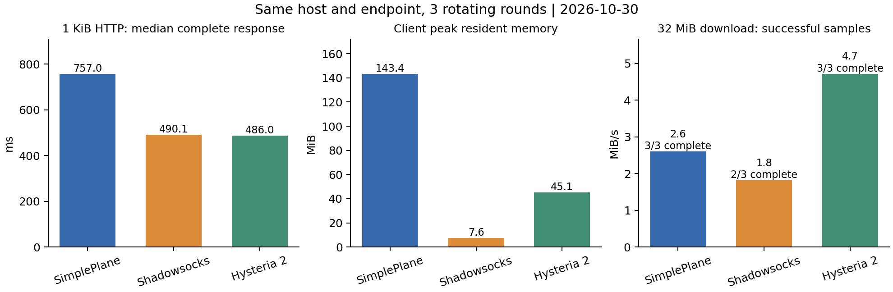

# SimplePlane / Shadowsocks / Hysteria 同机同线路性能测试

日期：2026-10-30。状态：**三工具三轮测试已执行完成**。
结果只适用于本轮服务器、线路和配置，不外推为所有设备与网络上的排名。

## 1. 环境与资源保护

服务器 `54.172.101.190`，2 vCPU、约 1909 MiB RAM；初始约 490 MiB 可用，2 GiB swap 已满，磁盘约 95% 使用。
客户端运行于用户本机的 WSL2 Ubuntu，使用独立随机 SOCKS 端口，不改变系统代理。不是 Windows GUI 的内存数据。
对比对象是代理内核，不含桌面 UI、TUN 驱动和系统代理集成的额外开销。

18443 公网探测超时后，按用户要求复用 **9090/TCP、9090/UDP**：只临时切换 nginx 的单个 upstream，从 `127.0.0.1:19090` 指向 `127.0.0.1:18443`，每轮恢复。
测试期间原代理的公网新连接可能受影响；原 Java 服务进程不替换。加入 nginx 配置校验、异常恢复、独立 45 分钟回滚定时器，最终校验配置摘要。
首次探测清理遗漏了立即恢复转发，已修正；正式测试前确认原配置 SHA-256 恢复一致，该探测不纳入正式统计。

三个新增代理逐个运行，均限制 `MemoryMax=256M`、`MemoryHigh=192M`、`MemorySwapMax=0`、`CPUQuota=100%`、`TasksMax=128`、最长运行 3600 秒。
源站 64 MiB、监控 48 MiB；可用内存低于 160 MiB 时停止新增负载并恢复路由。正式采样窗口最低可用内存 **248.5 MiB**。
共享 nginx、源站和后台服务不计入单个代理进程 RSS。这不是独占机器测试，现网后台负载会影响结果。

## 2. 版本和配置

| 对象 | 配置 |
| --- | --- |
| SimplePlane | 本地采集时 HEAD `ad3cf591dc82`，远端使用已部署 `b125737` JAR；HTTP/3、单条物理连接、`chacha20-poly1305-v2` + QUIC TLS；业务线程 4、worker 2；两端 JVM heap 96 MiB、direct 48 MiB；隔离实例不加载现网 agent |
| Shadowsocks-rust 1.25.0 | 官方 musl 二进制，`chacha20-ietf-poly1305`、TCP、worker 2、TCP_NODELAY |
| Hysteria 2.13.0 | 官方 Linux amd64 二进制，QUIC/TLS，不设固定带宽、不加混淆；`GOMAXPROCS=2`、`GOMEMLIMIT=160MiB` |

来源：[Shadowsocks 发布](https://github.com/shadowsocks/shadowsocks-rust/releases/tag/v1.25.0)、[Hysteria 发布](https://github.com/HyNetworks/hysteria/releases/tag/app/v2.13.0)、[Hysteria 服务端配置](https://hy2.app/docs/advanced/Full-Server-Config/)、[客户端配置](https://hy2.app/docs/advanced/Full-Client-Config/)。
二进制按官方摘要校验；完整 SHA-256 见相邻 `environment.json`。git HEAD 不能代替 JAR 内容证明。
协议封装、加密次数、拥塞控制及成功握手语义不同，这是工具整体行为比较。SOCKS 返回成功不保证远端就绪语义完全一致，主要依据完整校验的响应。
SimplePlane 默认客户端限流保持启用；本次没有为改善分数修改生产源码或默认限制。

## 3. 方法与口径

三轮顺序为 SP→SS→HY、SS→HY→SP、HY→SP→SS；同服务器、同数值端口、同受控源站。
每轮热身 5 次，再测 15 次新隧道 HTTP、20 次长连接 HTTP、6 次 HTTPS、3 次模拟页面；原始样本分别记录建连、TLS、TTFB 和完整耗时。
Java 只做了这段短时热身；结果覆盖冷启动后的短时使用，不能称作充分 JIT 预热后的长期稳态峰值。
源站使用远端私有 DNS 名称，排除本地私网直连；内存生成固定数据，上传/下载均验证长度与 SHA-256。

模拟页面：32 KiB 文档后用 6 条持久 TLS 连接读取 12 个 32 KiB 资源，共 416 KiB。它不是浏览器渲染/FCP/LCP，Python TLS 源站能力也可能限制该项。
测 32 MiB 下载、8 MiB 上传、4 路各 8 MiB 下载；吞吐为成功校验字节/完整耗时，包含连接开销，不称为稳态带宽。
并发及大吞吐阶段之间冷却 1.5 秒，避免上一阶段固定秒限流污染下一阶段；另测后台下载时延迟、公开 HTTPS 和服务重启恢复。
请求有整体耗时预算，失败保留。成功 QPS 只计成功请求，快速拒绝不计作高性能。
延迟列为 **中位数 / P95**，括号是 **成功/总样本**。P95 是经验分位数；只有三次的吞吐、启动与恢复样本不足以提供稳定尾部保证。
耗时和吞吐分位数只使用成功样本，属于条件统计；必须同时阅读失败率，不能把超时样本当作已经完成的慢请求，或从结论中删去。
启动 30 秒未就绪的记录保留为失败；如补跑缺失阶段，原失败仍计入冷启动成功率，补跑不替换原始记录。补跑发生在主轮换之后，因此缺失阶段的时间均衡控制弱于原计划。
该次 SimplePlane 就绪失败没有观察到 OOM；服务端最后的 143 是测试清理时发送 SIGTERM 的结果，不能据此称作进程崩溃。握手/转发失败的具体根因尚未定位。

## 4. 正式结果



本轮新隧道 HTTP 中位数最低为 `hysteria`，客户端 RSS 高水位最低为 `shadowsocks`。在完成的 32 MiB 样本中，吞吐中位数最高为 `hysteria`；务必结合成功样本数，超时不能从结论中隐藏。

| 指标 | SimplePlane | Shadowsocks-rust | Hysteria 2 |
| --- | --- | --- | --- |
| 本地冷启动至首次完整 HTTP，ms | 6981.67 / 7564.26 (3/4) | 1111.67 / 1225.86 (3/3) | 2106.36 / 2208.57 (3/3) |
| 新隧道 + 1 KiB HTTP，ms | 757.01 / 780.35 (45/45) | 490.12 / 526.05 (45/45) | 485.97 / 532.91 (45/45) |
| 复用隧道 + 1 KiB HTTP，ms | 251.05 / 256.83 (60/60) | 247.92 / 256.64 (60/60) | 242.28 / 257.01 (60/60) |
| 新隧道 + TLS + 1 KiB HTTPS，ms | 1013.42 / 1291.39 (18/18) | 759.22 / 1769.83 (18/18) | 738.75 / 1042.83 (18/18) |
| 模拟页面加载，ms | 3789.08 / 5039.12 (9/9) | 3983.58 / 4742.43 (9/9) | 3297.36 / 3913.61 (9/9) |
| 32 MiB 单路下载，MiB/s | 2.60 (3/3) | 1.82 (2/3) | 4.72 (3/3) |
| 8 MiB 上传，MiB/s | 未成功/未采样 (0/3) | 1.12 (3/3) | 2.36 (3/3) |
| 4×8 MiB 下载，MiB/s | 3.22 (3/3) | 1.50 (1/3) | 7.41 (3/3) |
| 后台下载时 1 KiB HTTP，ms | 804.91 / 1161.70 (36/36) | 512.10 / 548.09 (36/36) | 497.63 / 923.84 (36/36) |
| 重启命令返回至新请求成功，ms | 7841.53 / 10763.07 (3/3) | 495.67 / 555.84 (3/3) | 25047.00 / 25058.34 (3/3) |
| 发起重启命令至新请求成功，ms | 11050.55 / 15389.88 (3/3) | 3841.96 / 4423.27 (3/3) | 28411.39 / 28426.38 (3/3) |

| 小请求并发数 | SimplePlane | Shadowsocks-rust | Hysteria 2 |
| --- | --- | --- | --- |
| 1 | 96/96；1.33 QPS | 96/96；1.96 QPS | 96/96；2.03 QPS |
| 4 | 96/96；5.24 QPS | 96/96；6.76 QPS | 96/96；7.77 QPS |
| 8 | 96/96；10.49 QPS | 96/96；15.05 QPS | 96/96；13.25 QPS |
| 16 | 75/96；15.65 QPS | 96/96；23.86 QPS | 96/96；21.79 QPS |

各档每轮 32 个请求，共三轮；QPS 为各轮成功 QPS 中位数，必须结合成功数阅读。

### 补充测量

三工具均追加同样的 1 MiB 与 8 MiB 下载，各 3 次、整体预算 90 秒；作为较小文件的独立场景，不覆盖 32 MiB 在 60 秒预算内的超时。
还对自建服务进程暂停 3 秒并自动继续，验证既有隧道与新隧道。这是进程停顿，不称作真实断网。

| 指标，中位数 / P95（成功/总数） | SimplePlane | Shadowsocks-rust | Hysteria 2 |
| --- | --- | --- | --- |
| 1 MiB 下载，MiB/s | 0.77 / 0.79 (3/3) | 0.47 / 0.48 (3/3) | 1.26 / 1.65 (3/3) |
| 8 MiB 下载，MiB/s | 1.67 / 1.73 (3/3) | 2.13 / 2.23 (3/3) | 4.29 / 5.62 (3/3) |
| 进程暂停 3 秒后，旧隧道响应 ms | 2999.79 / 2999.79 (1/1) | 3010.39 / 3010.39 (1/1) | 2994.03 / 2994.03 (1/1) |
| 暂停恢复后，新隧道响应 ms | 752.51 / 752.51 (1/1) | 505.57 / 505.57 (1/1) | 499.18 / 499.18 (1/1) |

## 5. 资源占用

| 指标 | SimplePlane | Shadowsocks-rust | Hysteria 2 |
| --- | --- | --- | --- |
| 客户端空闲 RSS 中位数，MiB | 109.53 | 6.55 | 27.11 |
| 客户端全过程 RSS 高水位，MiB | 143.35 | 7.62 | 45.11 |
| 服务端进程 RSS 高水位，MiB | 208.15 | 6.81 | 36.94 |
| 服务端 cgroup 采样峰值，MiB | 194.33 | 22.62 | 41.42 |
| 每轮客户端 CPU 累计秒中位数 | 7.38 | 0.74 | 1.97 |
| 每轮服务端 CPU 采样累计秒中位数 | 7.73 | 0.30 | 2.98 |
| 服务端单次 cgroup 的 memory.high 事件最大值 | 290.00 | 0.00 | 0.00 |
| 客户端最大线程数 | 34.00 | 4.00 | 8.00 |
| 客户端最大 FD 数 | 44.00 | 75.00 | 25.00 |

客户端每 0.5 秒、服务端每 1 秒采样。RSS 高水位使用 `/proc` VmHWM；cgroup 峰值为采样所见，可能漏掉短促峰值。
服务端 CPU 用各轮负载窗口内相邻 cgroup 采样的累计量差，起止存在约 1 秒采样误差；不包含共享 nginx 和源站。
空闲是热身后 3 秒的短窗口。CPU 秒包含各实现实际完成的样本，失败导致有效工作量不同，不能直接当作每有效 MiB 的效率排名。
OOM kill、内存上限事件、swap、线程和 FD 的完整数据见 `analysis.json` 及轨迹。
本轮 SimplePlane 触发了 `MemoryHigh=192M` 的软阈值，单次 cgroup 的事件计数最高为 290；其他两个实现为 0。未观察到硬内存上限或 OOM kill 事件。因而这是相同内存预算下的表现，不能直接作为更宽裕内存配置的峰值结果。

## 6. 故障、失败与公开网站

仅停止自建对比实例；停止命令返回后至少等 3 秒，探测旧流，再启动并验证新连接，最多观察 45 秒。
分别记录发起重启命令及命令返回后的耗时，以区别 SSH/启动控制面。至少保持 3 秒不等于精确断网 3 秒。

- simpleplane：{'预算内无响应（不等于已观察到 TCP 关闭）': 3}。
- shadowsocks：{'旧流读取失败/被拒绝': 3}。
- hysteria：{'预算内无响应（不等于已观察到 TCP 关闭）': 3}。

这测服务重启，不等于随机丢包、移动换网、多节点切换或旧 TCP 流无缝迁移。旧流失效与新连接恢复分开统计。

**恢复超时配置说明：** SimplePlane 主测试两端设 10 秒 idle timeout。Hysteria 客户端虽然请求设 10 秒，但本版默认 Chrome 指纹模拟会将有效值固定为 30 秒，详见[官方客户端配置说明](https://hy2.app/docs/advanced/Full-Client-Config/)。主表恢复耗时包含策略差异，不据此判定重连算法优劣。
追加测试把 SimplePlane 两端也设为 30 秒，Hysteria 保持默认指纹模拟与有效 30 秒，仅测恢复，不替换主表：

```json
[
  {
    "tool": "simpleplane",
    "ok": true,
    "post_ack_ms": 25897.640423999746,
    "restart_to_success_ms": 29597.350473000006
  },
  {
    "tool": "hysteria",
    "ok": true,
    "post_ack_ms": 24753.503772000386,
    "restart_to_success_ms": 28246.38981199996
  }
]
```

该附加配置每工具一次，仅验证现象，不提供稳定 P95；统一 idle timeout 也不等于把所有重试和 keep-alive 策略统一。

失败分类：

- `simpleplane/upload_8mib/`：3 个失败样本；{'RemoteDisconnected: Remote end closed connection without response': 3}。
- `simpleplane/public_https/www.wikipedia.org`：6 个失败样本；{'AssertionError: 403': 6}。
- `shadowsocks/download_32mib/`：1 个失败样本；{'TimeoutError: Overall request time budget exceeded': 1}。
- `shadowsocks/parallel_download_4x8mib/`：2 个失败样本；{'并发子请求失败，见 requests': 2}。
- `shadowsocks/background_download_16mib/`：2 个失败样本；{'TimeoutError: Overall request time budget exceeded': 2}。
- `shadowsocks/public_https/www.wikipedia.org`：6 个失败样本；{'AssertionError: 403': 6}。
- `shadowsocks/public_https/www.cloudflare.com`：1 个失败样本；{'TimeoutError: Overall request time budget exceeded': 1}。
- `hysteria/public_https/www.wikipedia.org`：6 个失败样本；{'AssertionError: 403': 6}。
- `simpleplane/block_error/`：1 个失败样本；{'RuntimeError(\'simpleplane not reachable: ["SOCKS connect failed: b\\\'\\\\\\\\x05\\\\\\\\x04\\\\\\\\x00\\\\\\\\x01\\\'", "SOCKS connect failed: b\\\'\\\\\\\\x05\\\\\\\\x04\\\\\\\\x00\\\\\\\\x01\\\'", "SOCKS connect failed: b\\\'\\\\\\\\x05\\\\\\\\x04\\\\\\\\x00\\\\\\\\x01\\\'"]\')': 1}。
- `simpleplane/concurrent_small_requests/`：2 个失败样本；{'并发子请求失败，见 requests': 2}。

| 公开 HTTPS 完整响应，ms | SimplePlane | Shadowsocks-rust | Hysteria 2 |
| --- | --- | --- | --- |
| example.com | 1029.57 / 1064.93 (6/6) | 756.96 / 787.47 (6/6) | 766.29 / 1014.26 (6/6) |
| www.wikipedia.org | 未成功/未采样 (0/6) | 未成功/未采样 (0/6) | 未成功/未采样 (0/6) |
| www.cloudflare.com | 1915.23 / 2248.84 (6/6) | 2556.03 / 4792.43 (5/6) | 1359.00 / 1539.79 (6/6) |

公开站点含 DNS、站点策略、TLS、响应大小与 CDN 波动，不作为纯代理核心排名。HTTP 403 是站点拒绝，保留为失败，不称作代理断线。
第二轮起追加只读 TCP `ss -tin` 轨迹，保留 RTT、拥塞窗口与可用的重传字段，见 `tcp-diagnostics.jsonl`；它不提供 UDP 丢包率，也不足以独自断定超时根因。

### 限流诊断

[`RateLimitFilter.java`](../../proxy-cluster/src/main/java/com/proxy/cluster/filter/RateLimitFilter.java) 不区分消息类型，固定秒窗口全局 500、单域名 50 次调用；DATA 等事件可能消耗额度，不是“50 个网页请求/秒”。
基线日志确有 `Domain rate limit exceeded`。上传阶梯中 32 KiB、256 KiB、1 MiB 成功，8 MiB 失败；冷却后独立小请求成功。
独立的现网原配置诊断中，冷却后 4×8 MiB 下载、1/4/8/16 并发的各 32 个请求均成功；正式三轮的成功数以主表为准，不能用这次诊断替代。前序窗口污染与持续上传问题需区分；没有宣称所有上传内部原因都已排除。
原始上传后整组拒绝保留于 `deployed-baseline.json`；追加诊断在 `deployed-diagnostic.json`，没有覆盖失败。

## 7. 现网原配置基线（单列）

现网 9090 为 legacy `chacha20`、加载 LogLens agent，与隔离测试的密码套件、线程、监控负担不同，不混合统计。

| 指标 | 成功样本 | 中位数 | P95 |
| --- | --- | --- | --- |
| 新隧道 HTTP | 15 | 754.72 ms | 774.12 ms |
| 长连接 HTTP | 20 | 251.99 ms | 268.17 ms |
| 新隧道 HTTPS | 6 | 1038.52 ms | 1101.99 ms |
| 模拟页面 | 3 | 7662.70 ms | 7834.67 ms |

一次 32 MiB 下载约 1.574 MiB/s；冷却后的 4×8 MiB 合计约 4.762 MiB/s。不是优化前后收益，也不是稳定线路上限。
早期一次大文件请求因测量器未设整体预算而被中断，未纳入吞吐；已补预算和超时校验用例。

## 8. 证据与复现

相邻目录保存原始样本、分组统计、资源轨迹、基线和诊断、环境摘要及清理证明；`manifest.json` 列出 SHA-256。
测量器 7 个校验用例通过：摘要校验、长连接、损坏、截断、并发失败计数和整体超时。
最终在实际采样所用的 WSL/Linux Python 下再次验证 7/7，通过日志见 `harness-verification-linux.log`。

```text
python scripts/perf/verify_harness.py
# 在本机 WSL 内；首次准备需官方发布文件及 prepare_comparison.py。
python3 scripts/perf/inspect_comparison.py setup
python3 scripts/perf/compare_proxies.py --probe
python3 scripts/perf/compare_proxies.py --rounds 3
python3 scripts/perf/inspect_comparison.py collect
python scripts/perf/write_report.py
```

准备脚本不会直接覆盖已有远端目录；认证和私钥只在私有测试目录，不复制进文档。
最终检查：原服务 `active`，PID `2489350`，guard 触发 `False`，nginx upstream 恢复 `True`；配置摘要见 `cleanup.json`。
`final-idle-snapshot.json` 确认四个测试单元均停止；`prune.json` 确认远端临时目录已移除，释放约 36.6 MiB，包含临时认证配置及证书私钥。

尚未覆盖：原生 Windows/macOS 资源、真实浏览器渲染、UDP 转发能力横评、人工丢包/抖动、移动换网、长期泄漏与极限并发。
2 GiB 机器仍有后台服务，本轮不做无限并发压垮测试，不能保证所有场景无异常。

## 9. 后续改进优先级

1. 先解决持续上传被默认限流拒绝的问题：明确 CONNECT、DATA、DISCONNECT 的计数职责，区分建连限流与字节流量限制，确保清理事件可以完成；保持当前失败样本作为回归依据。
2. 给启动失败保留更具体的握手和重试原因，定位 30 秒未就绪的单次问题，不能仅扩大等待时间后把它忽略。
3. 功能问题解决后，再分别做充分 JIT 预热、QUIC 窗口和 JVM 内存配置实验；每次只改变明确参数，重新比较吞吐、尾延迟与内存，当前数据不能独自量化各项贡献。
